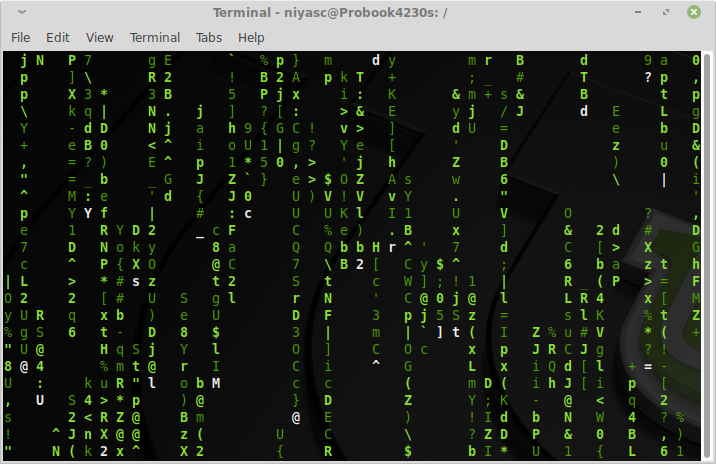

**A** small set of Linux commands covers most everyday work in the terminal. With them you can move around folders, manage and find files, search text, see what's running, check disk space, change permissions and edit a file over SSH. Each section below gives the command, what it does and an example you can try right away. The commands work the same way on [Ubuntu](/distribution/ubuntu), [Debian](/distribution/debian), [Fedora](/distribution/fedora), [Arch Linux](/distribution/arch) and almost every other distribution.


*The terminal on [Linux Mint](/distribution/linuxmint) 19.2 Xfce Edition, running the cmatrix command*

## Getting help: man and --help

Before anything else, know how to look up a command. `man` opens the full manual page, and most commands print a short summary with `--help`. In `man`, press `/` to search and `q` to quit.

```sh
$ man grep
$ ls --help
```

## Navigating and listing files

- `pwd` prints the current working directory.
- `ls -la` lists all files, including hidden ones, with permissions, owner, size and modification date.
- `cd <path>` changes directory. `cd ..` goes up one level and `cd ~` (or just `cd`) goes to your home directory.

```sh
$ pwd
/home/user/projects

$ ls -la
drwxr-xr-x  4 user user 4096 Aug  3 10:00 .
-rw-r--r--  1 user user  220 Aug  3 10:00 notes.txt
```

## Creating, copying, moving and deleting files

- `mkdir -p a/b/c` creates a directory, including any missing parent directories.
- `cp file copy` copies a file. Add `-r` to copy a directory and everything in it.
- `mv old new` moves or renames a file or directory.
- `rm file` deletes a file. `rm -r dir` deletes a directory and its contents.

```sh
$ mkdir -p backups/2026
$ cp -r projects backups/2026/
$ mv notes.txt notes-old.txt
```

`rm` does not use a trash bin, so deleted files are gone. Add `-i` to be asked before each deletion while you get used to it.

## Viewing file contents

- `cat file` prints a whole file, which is handy for short files.
- `less file` opens a long file one screen at a time. Use the arrow keys to scroll, `/` to search and `q` to quit.
- `head -n 20 file` and `tail -n 20 file` show the first or last 20 lines.
- `tail -f file` keeps printing new lines as they are added, which is useful for watching logs.

```sh
$ tail -f /var/log/syslog
```

## Finding files with find

`find` searches a directory tree for files that match a name or other conditions.

```sh
$ find <directory> -name "<pattern>"     # case-sensitive name match
$ find <directory> -iname "<pattern>"    # case-insensitive name match
```

For example, to find every `.log` file under `/var/log`:

```sh
$ find /var/log -name "*.log"
```

A few more conditions you can combine with the name:

- `-type f` or `-type d` matches only files or only directories.
- `-mtime -7` matches files modified in the last 7 days.
- `-size +100M` matches files larger than 100 MB.

```sh
$ find ~ -type f -size +100M
```

By default `find` does not follow symbolic links. To follow them, put `-L` before the directory: `find -L /path -name "*.conf"`.

## Searching text inside files with grep

`grep` prints every line that contains a piece of text.

```sh
$ grep "text" <file>
$ grep -r "text" <directory>      # search every file under a directory
```

Example: find every mention of "TODO" in the current project, with line numbers.

```sh
$ grep -rn "TODO" .
./src/app.js:42:// TODO: handle empty response
```

Useful options:

- `-i` ignores case.
- `-n` shows the line number of each match.
- `-l` lists only the names of files that match.
- `-v` inverts the match and shows lines that do **not** contain the text.
- `-c` prints the number of matching lines instead of the lines.
- `-E` enables extended regular expressions, such as `grep -E "error|warning"`.

## Pipes and redirection

Pipes and redirection let you combine commands and save their output.

- `command > file` writes the output to a file, replacing its contents.
- `command >> file` appends the output to the end of a file.
- `command1 | command2` sends the output of `command1` to `command2` as input.

```sh
$ ls -la /etc | grep ".conf"
$ dmesg | tail -n 50 > boot-messages.txt
```

## Checking running processes

- `ps aux` lists every running process.
- `top` (or `htop`, if installed) shows a live view of processes sorted by CPU or memory use. Press `q` to quit.
- `kill <pid>` asks a process to stop, using its process ID from `ps` or `top`.
- `kill -9 <pid>` forces a process to stop. Use it only when a normal `kill` doesn't work, because the program gets no chance to save its data.

```sh
$ ps aux | grep firefox
user      2345  2.3  4.1  ...  firefox
$ kill 2345
```

## Checking disk space

- `df -h` shows free and used space on each mounted drive, in human-readable sizes.
- `du -sh <directory>` shows how much space a directory uses.

```sh
$ df -h /
$ du -sh ~/Downloads
```

## File permissions and sudo

`ls -l` shows permissions as a 10-character string such as `-rwxr-xr--`. After the first character (the file type), the three groups of `rwx` are read, write and execute permissions for the owner, the group and everyone else.

- `chmod +x script.sh` makes a file executable.
- `chmod 755 file` gives the owner read, write and execute access, and everyone else read and execute access.
- `chown user:group file` changes the owner and group of a file.
- `sudo <command>` runs a single command with administrator (root) rights, for example to install software or edit system files.

```sh
$ chmod +x backup.sh
$ sudo chown www-data:www-data /var/www/site
```

## Editing files with vi and vim

`vi`, or its improved version `vim`, is the editor you are most likely to find on any Linux server. It has two main modes:

- **Normal mode** is for moving around and running commands. vi starts in this mode.
- **Insert mode** is for typing text. Press `i` to enter it and `Esc` to return to normal mode.

Saving and quitting (type these in normal mode):

- `:w` saves the file.
- `:q` quits, and `:q!` quits without saving.
- `:wq` saves and quits.

Moving around:

- `h`, `j`, `k` and `l` move left, down, up and right.
- `w` and `b` jump one word forward or back.
- `0` and `$` jump to the start or end of the line.
- `G` goes to the last line, and `nG` goes to line `n`.

Editing:

- `i` inserts text before the cursor, and `a` appends text after it.
- `x` deletes the character under the cursor.
- `dd` deletes the current line.
- `cw` replaces the rest of the word, and `cc` replaces the whole line.
- `yy` copies (yanks) the current line, and `p` pastes after the cursor.
- `u` undoes the last change.

Searching and replacing:

- `/text` searches forward and `?text` searches backward. `n` and `N` jump to the next or previous match.
- `:s/old/new/` replaces the first match on the current line.
- `:%s/old/new/g` replaces every match in the whole file.

If you'd prefer a more modern terminal app to run these commands in, [Tabby](/software/tabby/) is worth a look.

## Next steps

Practise these commands on a test directory until they feel natural, and use `man <command>` whenever you need an option that isn't listed here. To work with media and documents from the terminal, see our guides to [FFmpeg commands](/ffmpeg-commands/), [converting images with ImageMagick](/00-convert-png-to-jpg-imagemagick/) and [reducing PDF file size with Ghostscript](/reduce-pdf-file-size-using-ghostscript-seo-optimized/).
