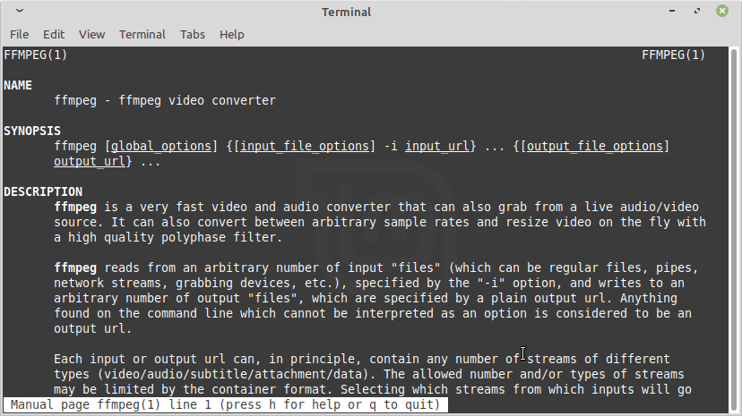

**FFmpeg** is a free, open-source command-line tool for converting, editing and streaming audio and video. It handles almost every media format and runs on Linux, macOS and Windows. Because it works from the terminal, it can process hundreds of files with a single script. This cheat sheet covers the FFmpeg commands you are most likely to need, each with a ready-to-use example.



## Installing FFmpeg

FFmpeg is in the repositories of most Linux distributions.

```sh
sudo apt install ffmpeg          # Debian, Ubuntu, Linux Mint
sudo dnf install ffmpeg-free     # Fedora (the full ffmpeg package is in RPM Fusion)
sudo pacman -S ffmpeg            # Arch Linux, Manjaro
```

Check that it works with `ffmpeg -version`.

## How FFmpeg commands are built

Most commands follow the same pattern:

```sh
ffmpeg -i <input-file> [options] <output-file>
```

FFmpeg picks the output format from the file extension. Two options appear again and again below:

- `-c:v` sets the video codec and `-c:a` sets the audio codec (`-c` sets both).
- `copy` as the codec copies the existing streams without re-encoding. It is very fast and keeps the original quality, but it only works when the output format supports the input codecs.

## Checking a file's format and streams

Start by finding out what a file contains. `ffprobe` is installed with FFmpeg and prints the container, codecs, resolution, duration and bitrate without changing the file.

```sh
ffprobe input.mp4
```

Knowing the codecs tells you whether you can use `copy` in the commands below or need to re-encode.

## Converting video to another format

To change the container without re-encoding, for example MKV to MP4:

```sh
ffmpeg -i input.mkv -c copy output.mp4
```

This fails if the MKV holds a stream that MP4 can't store, such as some subtitle formats. In that case, drop the subtitles with `-sn`, or re-encode to widely supported codecs:

```sh
ffmpeg -i input.mkv -c:v libx264 -c:a aac output.mp4
```

By default FFmpeg keeps one video and one audio stream. Add `-map 0` to keep every stream, such as extra audio tracks. To see all available codecs, run `ffmpeg -codecs`.

## Trimming a video by start and end time

```sh
ffmpeg -i input.mp4 -ss 00:01:30 -to 00:02:45 -c copy clip.mp4
```

This keeps the part between 1:30 and 2:45. Times use the `HH:MM:SS` format or plain seconds, such as `90`. With `-c copy`, the cut can only start on a keyframe, so the clip may begin a little earlier than requested. For a frame-accurate cut, re-encode by removing `-c copy`.

If you'd rather trim on a visual timeline, a video editor like [Kdenlive](/software/kdenlive/) or [Shotcut](/software/shotcut/) can do the same job.

## Extracting audio from a video

```sh
# Keep the original audio (use the extension that matches its codec, e.g. .aac or .opus)
ffmpeg -i input.mp4 -vn -c:a copy output.aac

# Convert the audio to MP3
ffmpeg -i input.mp4 -vn -c:a libmp3lame -q:a 2 output.mp3
```

`-vn` removes the video stream. `-q:a 2` gives high-quality variable-bitrate MP3; higher numbers make smaller files.

## Compressing a video

```sh
ffmpeg -i input.mp4 -c:v libx264 -crf 28 -preset slow -c:a copy output.mp4
```

`-crf` (constant rate factor) sets the balance between quality and file size for H.264. Lower values mean better quality and bigger files: `18` looks almost identical to the source, `23` is the default, and `28` gives a much smaller file with visible quality loss. A slower `-preset` produces a smaller file at the same quality but takes longer to encode.

For even smaller files, use H.265 with `-c:v libx265`. Its default CRF is `28`, and older devices may not play it.

## Resizing a video

```sh
ffmpeg -i input.mp4 -vf scale=1280:-2 -c:a copy output.mp4
```

This scales the video to 1280 pixels wide. `-2` calculates the height from the original aspect ratio and rounds it to an even number, which H.264 requires.

## Making a GIF from a video

```sh
ffmpeg -i input.mp4 -vf "fps=10,scale=480:-1:flags=lanczos,split[a][b];[a]palettegen[p];[b][p]paletteuse" output.gif
```

GIFs can only use 256 colours. This filter creates a colour palette from the video first, which gives much cleaner results than a direct conversion. Lower the `fps` or `scale` values to make the file smaller. Add `-ss` and `-t` before `-i` to convert only part of the video, for example `-ss 10 -t 5` for five seconds starting at 0:10.

## Turning an image sequence into a video

```sh
ffmpeg -framerate 24 -i frame%03d.png -c:v libx264 -pix_fmt yuv420p output.mp4
```

`frame%03d.png` matches `frame001.png`, `frame002.png` and so on. `-pix_fmt yuv420p` makes the video play in most players and browsers.

## Joining several videos into one

List the files to join in a text file, one per line:

```
file 'part1.mp4'
file 'part2.mp4'
```

Then run:

```sh
ffmpeg -f concat -safe 0 -i list.txt -c copy output.mp4
```

This works without re-encoding only when all the files use the same codecs, resolution and frame rate. Otherwise, convert them to matching settings first.

## Next steps

Check the result in a player such as [VLC](/software/vlc/) or [mpv](/software/mpv/) before deleting your originals. For every option, see the [official FFmpeg documentation](https://ffmpeg.org/ffmpeg.html). If you work with images as well as video, our [ImageMagick conversion guide](/00-convert-png-to-jpg-imagemagick/) covers the same kind of batch tasks for pictures.
