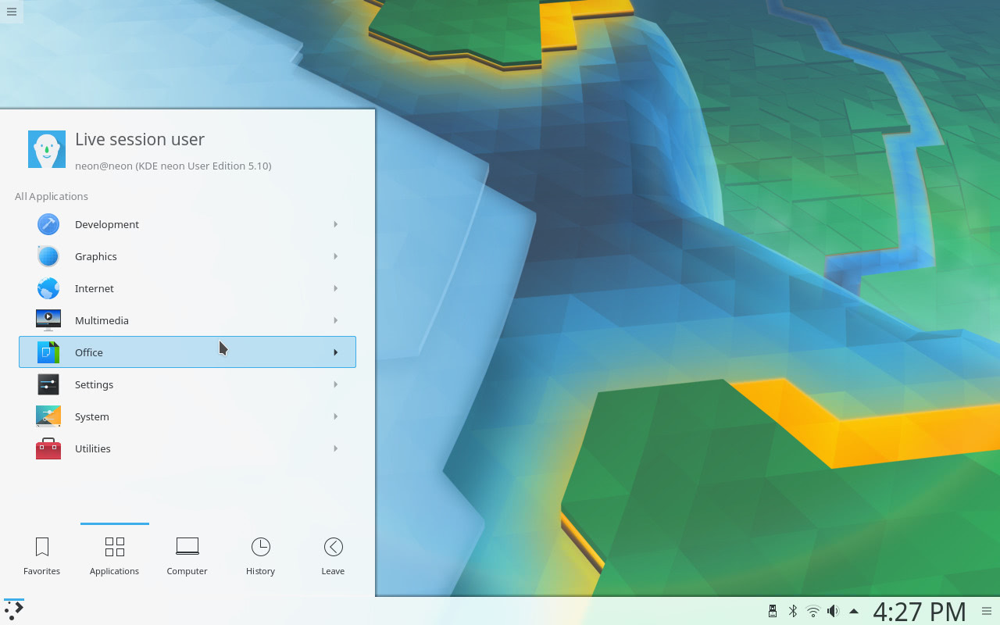

**Converting** PNG images to JPG is the quickest way to shrink photos and screenshots for the web or email. On Linux, the free and open-source ImageMagick suite does it with one command, and it can convert a whole folder at once. This guide shows how to convert a single file, control the JPG quality, handle transparent backgrounds and batch-convert many images.

**Quick answer:** run `magick image.png image.jpg` with ImageMagick 7, or `convert image.png image.jpg` with ImageMagick 6. Add `-quality 85` to control the file size.

## PNG vs JPG: when to convert

Both PNG and JPG are raster formats, which store an image as a grid of pixels. The difference is how they compress that grid:

- **PNG** uses lossless compression, so every pixel is kept exactly. It also supports transparency. It is best for screenshots with text, logos, icons and simple graphics, but photographs saved as PNG produce large files.
- **JPG** (or JPEG) uses lossy compression. It discards detail the eye is unlikely to notice, and you choose how much. It doesn't support transparency, but it makes photographs far smaller than PNG.


*PNG suits simple graphics such as icons and shapes*


*Detailed, photo-like images are much smaller as JPG*

Convert PNG to JPG when the image is a photo or a detailed picture and a smaller file matters more than pixel-perfect quality. Keep PNG for images with sharp text, flat colours or transparency.

## Installing ImageMagick

ImageMagick is available in the repositories of all major distributions:

```bash
sudo apt install imagemagick      # Debian, Ubuntu, Linux Mint
sudo dnf install ImageMagick      # Fedora
sudo pacman -S imagemagick        # Arch Linux, Manjaro
```

## ImageMagick 6 or 7: convert or magick

ImageMagick 7 replaced the `convert` command with `magick`. Fedora and Arch Linux ship version 7, while Ubuntu 24.04 LTS still ships version 6. To see which one you have, run:

```bash
magick -version     # works on ImageMagick 7
convert -version    # works on ImageMagick 6 (and prints a deprecation warning on 7)
```

The options are the same in both versions. The examples below use `magick`; on ImageMagick 6, replace `magick` with `convert`, and `magick mogrify` with `mogrify`.

## Convert a single PNG to JPG

```bash
magick image.png image.jpg
```

ImageMagick reads the format from the file extensions, so this works for almost any pair of formats, for example `magick image.png image.webp`.

## Control JPG quality and file size

The `-quality` option sets the JPG compression level from 1 to 100. Higher values keep more detail and produce larger files.

```bash
magick image.png -quality 85 image.jpg
```

A value of 85 to 90 keeps photos looking close to the original with a large size saving. Values of 60 to 75 give much smaller files with some visible artefacts. If you don't set `-quality`, ImageMagick uses the source image's quality when it can tell, and 92 otherwise.

## Convert PNGs with a transparent background

JPG can't store transparency. When you convert a PNG with transparent areas, those areas may turn black or show unexpected colours. Choose the background colour yourself and fill the transparent areas with it:

```bash
magick image.png -background white -alpha remove -alpha off image.jpg
```

Replace `white` with any colour name or hex code, such as `"#f0f0f0"`.

## Batch-convert all PNG files in a folder

`mogrify` converts every matching file in one command. With `-format`, it writes new JPG files next to the originals and leaves the PNG files unchanged:

```bash
magick mogrify -format jpg -quality 85 *.png
```

To also flatten transparent backgrounds:

```bash
magick mogrify -format jpg -quality 85 -background white -alpha remove -alpha off *.png
```

To write the JPG files to another folder, add `-path`:

```bash
mkdir jpg
magick mogrify -path jpg -format jpg -quality 85 *.png
```

## Frequently asked questions

**Does converting PNG to JPG reduce image quality?**
Yes, because JPG is lossy. At `-quality 90` or higher the difference is usually hard to see, but every conversion discards some detail.

**Why is my JPG larger than the original PNG?**
This happens with simple graphics, such as screenshots with flat colours, that PNG already compresses very well. Keep those as PNG.

**Can I use these commands on Windows or macOS?**
Yes. ImageMagick is cross-platform, and the `magick` commands are the same. Only shell syntax such as wildcards may differ on Windows.

## Next steps

To go the other way, see our guide on [converting JPG to PNG with ImageMagick](/convert-jpg-to-png-imagemagick/). For the full list of options, see the [ImageMagick command-line documentation](https://imagemagick.org/script/command-line-processing.php). If you edit images by hand, [GIMP](/software/gimp/) can also export PNG files to JPG.
