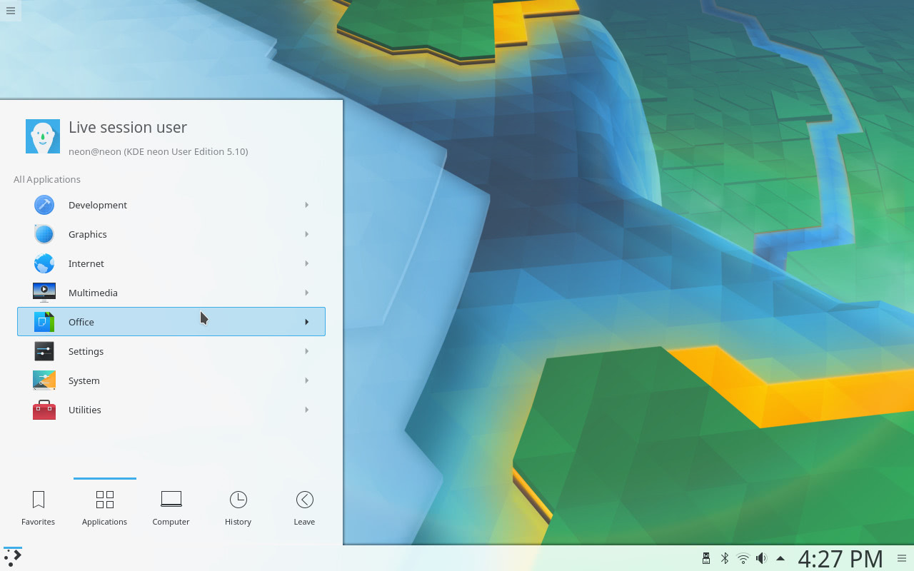

**You** can convert a JPG image to PNG on Linux with a single ImageMagick command, and convert a whole folder just as easily. This guide shows both, explains when switching to PNG actually helps, and covers how to keep the larger PNG files under control.

**Quick answer:** run `magick photo.jpg photo.png` with ImageMagick 7, or `convert photo.jpg photo.png` with ImageMagick 6.



New to ImageMagick? Our [PNG to JPG guide](/00-convert-png-to-jpg-imagemagick/) explains how to install it, the difference between ImageMagick 6 and 7, and how the PNG and JPG formats compare.

## When converting JPG to PNG makes sense

- **You will keep editing the image.** Each time a JPG is saved, it loses a little more detail. Working in PNG, which is lossless, stops that further loss.
- **You need transparency.** PNG supports transparent areas and JPG doesn't, so a logo or cut-out has to be PNG.
- **A tool or website requires PNG**, for example for icons or app assets.

Converting does **not** improve quality. Any detail or blockiness lost when the JPG was saved stays in the PNG, and the file usually becomes several times larger.

## Convert a single JPG to PNG

```bash
magick photo.jpg photo.png
```

On ImageMagick 6, use `convert` in place of `magick`.

## Batch-convert all JPG files in a folder

```bash
magick mogrify -format png *.jpg
```

This writes a PNG next to every JPG and leaves the originals unchanged. Use `*.jpeg` as well if some files have that extension, and add `-path png` to save the results in a `png` folder (create it first with `mkdir png`). On ImageMagick 6, run `mogrify` without `magick`.

## Keep the PNG files smaller

PNG files of photographs are large. Two options help without losing any more quality:

```bash
magick photo.jpg -strip -define png:compression-level=9 photo.png
```

- `-strip` removes metadata such as camera details and embedded previews.
- `png:compression-level=9` uses the strongest lossless compression. It is slower but makes the file smaller.

If the image is a photo and you don't need transparency or further editing, keeping it as JPG is usually the better choice.

## Add a transparent background

Converting alone doesn't make anything transparent. To turn one solid background colour transparent, for example the white around a logo, use:

```bash
magick logo.jpg -fuzz 10% -transparent white logo.png
```

`-fuzz 10%` also catches near-white pixels left by JPG compression. Increase it if a light edge remains, and lower it if parts of the logo disappear.

## Next steps

For converting PNG back to JPG, quality settings and handling transparency, read our [PNG to JPG guide](/00-convert-png-to-jpg-imagemagick/). For more terminal basics, see [essential Linux commands every user should know](/1-essential-linux-commands/).
