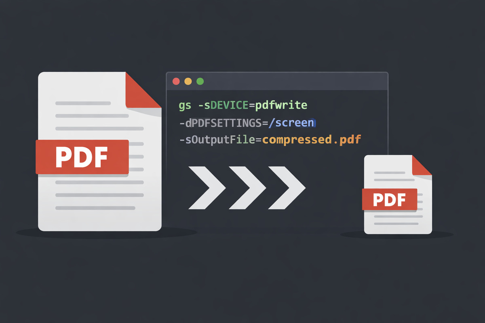

**Large** PDF files are hard to email, upload or share, and scanned documents are often the worst offenders. On Linux, you can shrink them offline with Ghostscript, a free, open-source tool that is already installed on many systems. This guide shows the command to use, how to choose the right quality preset, and how to compress a whole folder of PDFs at once.



## Why PDF files get large

Most of the size in a large PDF comes from images: scanned pages, photos and high-resolution graphics. Embedded fonts add a little more. Ghostscript reduces the size mainly by lowering the resolution of those images and recompressing them, and by removing duplicate resources. Because the PDF is processed on your own computer, nothing is uploaded, which makes it a good choice for private documents.

## Install Ghostscript

Check whether it is already installed:

```sh
gs --version
```

If not, install it from your distribution's repositories:

```sh
sudo apt install ghostscript      # Debian, Ubuntu, Linux Mint
sudo dnf install ghostscript      # Fedora
sudo pacman -S ghostscript        # Arch Linux, Manjaro
```

## Compress a PDF

```sh
gs -sDEVICE=pdfwrite -dCompatibilityLevel=1.4 -dPDFSETTINGS=/ebook \
   -dNOPAUSE -dQUIET -dBATCH \
   -sOutputFile=output.pdf input.pdf
```

What each part does:

- `-sDEVICE=pdfwrite` writes a new PDF file.
- `-dCompatibilityLevel=1.4` makes the output readable by practically every PDF viewer.
- `-dPDFSETTINGS=/ebook` picks the quality preset (see the next section).
- `-dNOPAUSE -dQUIET -dBATCH` runs the job without prompts or progress messages and exits when done.
- `-sOutputFile=output.pdf` is the new, smaller file. Always use a different name from the input, because Ghostscript can't safely overwrite the file it is reading.

## Choose the right quality preset

`-dPDFSETTINGS` controls how much the images are reduced. Start with `/ebook`, and switch to `/screen` only if the file is still too large.

| Preset | What happens to images | Best for |
|--------|------------------------|----------|
| `/screen` | Reduced to 72 dpi | Smallest files for email and chat; images look soft when zoomed or printed |
| `/ebook` | Reduced to 150 dpi | Reading on screens; a good balance of size and quality |
| `/printer` | Recompressed, resolution kept | Office and home printing |
| `/prepress` | Recompressed, resolution and colour information kept | Professional printing; files stay larger |
| `/default` | Recompressed, resolution kept | General use; usually the smallest saving |

Only `/screen` and `/ebook` lower the image resolution, so they give by far the biggest size reduction. `/screen` also skips embedding some fonts, so text may look slightly different on computers that lack those fonts.

Text in a PDF is stored as text, not as an image, so it stays sharp with every preset. In scanned documents, though, each page is an image, so text becomes blurrier at lower settings.

## Set a custom image resolution

If `/screen` is too blurry and `/ebook` is too large, set the resolution yourself. This example reduces all images to 100 dpi:

```sh
gs -sDEVICE=pdfwrite -dCompatibilityLevel=1.4 -dPDFSETTINGS=/ebook \
   -dDownsampleColorImages=true -dColorImageResolution=100 \
   -dDownsampleGrayImages=true -dGrayImageResolution=100 \
   -dDownsampleMonoImages=true -dMonoImageResolution=100 \
   -dNOPAUSE -dQUIET -dBATCH \
   -sOutputFile=output.pdf input.pdf
```

## Compress all PDFs in a folder

This loop saves a compressed copy of every PDF in the current folder into a `compressed` folder, leaving the originals untouched:

```sh
mkdir -p compressed
for f in *.pdf; do
  gs -sDEVICE=pdfwrite -dCompatibilityLevel=1.4 -dPDFSETTINGS=/ebook \
     -dNOPAUSE -dQUIET -dBATCH \
     -sOutputFile="compressed/$f" "$f"
done
```

## Compare the file sizes

```sh
ls -lh input.pdf output.pdf
```

Scanned and image-heavy PDFs usually shrink the most. A PDF that contains mostly text, or one that is already optimised, may hardly shrink at all and can even grow. In that case, keep the original.

## Frequently asked questions

**Does Ghostscript reduce image quality?**
It can. `/screen` and `/ebook` lower the resolution of images, and every preset recompresses them. Open the result and check it before deleting the original.

**Will links, bookmarks and form fields still work?**
Links and bookmarks are usually kept. Interactive form fields and digital signatures may not survive, so test the output, and don't compress a signed document if the signature must stay valid.

**Is there a graphical alternative?**
Yes. Some PDF tools offer compression from a menu, but Ghostscript is faster for many files and gives you exact control. You can view the result in a PDF reader such as [Okular](/software/okular/).

## Next steps

Save the compression command as a shell alias or script so you can reuse it in one step. For more terminal skills, see [essential Linux commands every user should know](/1-essential-linux-commands/). The [Ghostscript documentation](https://ghostscript.readthedocs.io/) lists every `pdfwrite` option.
