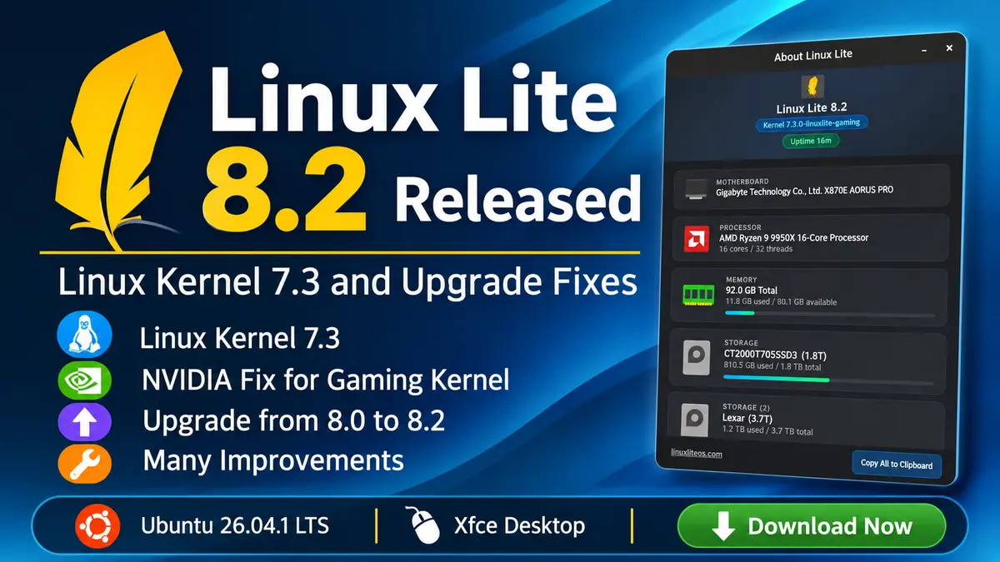

**Linux Lite** 8.2 is now available for download. The point release moves the distribution to Linux kernel 7.3 and sits on Ubuntu 26.04.1 LTS with Xfce. Most existing 8.0 users can upgrade in place with the Lite Upgrade tool.

## What is new in Linux Lite 8.2

The project calls 8.2 a minor release, and the headline change is the new kernel. Linux Lite builds its own kernels from the mainline tarball on kernel.org, checks the GPG signature, and adds a selection of CachyOS patches. It ships two flavours through the Lite Kernel Manager:

- **linuxlite**: the default desktop kernel, with dynamic preemption and CPU mitigations on.
- **linuxlite-gaming**: an optional kernel with full preemption, mitigations off, and the BORE scheduler for lower input lag.

The more interesting news for NVIDIA owners is a new `linuxlite-nvidia-kernel-patch` package. Mainline 7.3 changed an internal cgroup function, and that broke the NVIDIA open kernel module build. The patch fixes the build, and the developers say driver 615.71.09 now compiles on the 7.3 gaming kernel. Lite Driver Manager recommends the package, so the fix is in place before you install a driver.

## Fixes and changes since 8.0

Linux Lite 8.0 arrived in June, and 8.2 rolls up several months of package updates. These stand out:

- **Encrypted installs work again.** The installer was missing steps for LUKS, which led to GRUB errors and a BusyBox prompt on first boot. A later fix also handles a "device busy" error that made a finished install look like a failure.
- **The upgrade tool now sees 8.2.** The repository version check pointed at a file that never parsed, so Lite Upgrade told 8.0 users there was nothing to do. It now reads a dedicated version endpoint. A second fix stops `/etc/issue` from being written across two lines after an upgrade.
- **USB Writer Formatter replaces Mintstick**, and Lite Core no longer lists Mintstick, Xfburn, HardInfo2, or GNOME System Log as removable apps.
- **Lite Software grows.** It adds Visual Studio Code, fixes Microsoft Edge, and lists 43 more apps, including Brave, Vivaldi, Discord, and Bitwarden. Manage All Software now offers a Reinstall option and category filters.
- **Lite Terminal** opens links with a plain click and has predictive autocomplete turned on.
- **New tweaks and tools.** Lite Tweaks can set up automatic updates, Lite Game Center installs the 32-bit graphics stack for Wine-GE, and Lite Kernel Manager can export its install log.

Linux Lite also changes how it presents releases from now on. Each one gets a full changelog and a complete package list as a .zip file. Screenshots will appear only when the interface changes in a major way. That suits a project that ships this many small updates, since the changelog tells you more than a screenshot.

## Upgrade from Linux Lite 8.0 to 8.2

Follow these steps on an existing 8.0 install:

1. Open Menu, Favorites, Install Updates, and reboot if asked.
2. Create a restore point in Timeshift.
3. Open Menu, Settings, Lite Upgrade.
4. Reboot when it finishes.

Run `apt policy lite-upgrade-series8` in a terminal first. You need version 8.0-0050-linuxlite or newer. If you still have an older build, wait 24 hours or switch to the default Linux Lite repository in Lite Software Sources. Lite Upgrade does not change your kernel, so install the 7.3 kernels from Lite Kernel Manager if you want them.

## Download and system requirements

The ISO is 2.4 GB and works on a DVD or a USB stick of 4 GB or more. The [official downloads are on SourceForge](https://sourceforge.net/projects/linux-lite/files/8.2/), with mirrors in more than ten countries and a torrent. Check your download with `sha256sum linux-lite-8.2-64bit.iso`. The expected hash is `c0967038ec23522648285d306021829bf4602327a137ecb1bdc3d4be4026e9b0`.

The project recommends:

- A 1.5 GHz dual-core processor
- 4 GB of RAM
- 40 GB of disk space
- A display that supports 1366x768

For a fresh install, set CSM to enabled and Secure Boot to disabled in the BIOS. After you install, run Install Updates first, because last-minute fixes often land after the ISO is built.

## Why this release matters

Linux Lite 8.2 is a polish release, but two parts deserve attention. The NVIDIA patch shows how much work it takes to ship a mainline kernel on top of an Ubuntu LTS base, since Ubuntu's own NVIDIA packages trail the kernel. The upgrade-tool fix matters too: 8.0 users could not see the 8.2 offer until it landed.

For background on the Series 8 base, read our coverage of [Linux Lite 8.0](/linux-lite-8-0-release/) and the [Ubuntu 26.04 LTS release](/ubuntu-26-04-resolute-raccoon-release/). If you want to see where the kernel patches come from, we also covered [CachyOS](/cachyos-august-2026-release/), the project behind them. Linux Lite explains the kernels in detail on its [kernel page](https://www.linuxliteos.com/linux-lite-kernel.html) and tracks user scores on its [benchmark page](https://www.linuxliteos.com/benchmark.php).

Sources: [Linux Lite 8.2 release announcement and changelog](https://www.linuxliteos.com/), [Linux Lite 8.2 on SourceForge](https://sourceforge.net/projects/linux-lite/files/8.2/)
