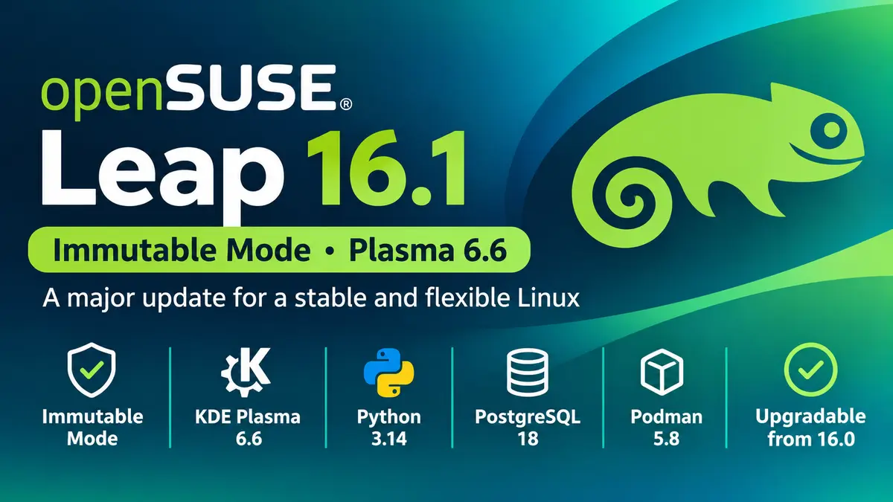

**openSUSE** Leap 16.1 is now available. The release, which landed on November 3, 2026, is the first minor update to the Leap 16 series. Its main change is a new Immutable Mode, and it replaces Leap Micro, the project's separate immutable system. You now choose between a regular install and an immutable one when you set up Leap.



## The short version

- **Immutable Mode** is built into Leap 16.1 and replaces Leap Micro. There will be no Leap Micro 6.3 or 7.0.
- **Same-day launch with SLES 16.1.** Leap now gets maintenance updates from day one.
- **KDE Plasma 6.6** replaces Plasma 6.4, and LXQt moves to 2.4.
- **Python 3.14, PostgreSQL 18, QEMU 11, and Podman 5.8** are new for developers and admins.
- **Leap 16.0 users can upgrade in place.**

## What Immutable Mode means for you

On a normal Linux install, you can change any file in the system. With Immutable Mode, the root filesystem is read-only. The system changes only through `transactional-update`, which takes a snapshot each time. If an update causes trouble, you roll back with one command.

This design suits machines you want to keep stable, such as container hosts, virtual machine hosts, and edge devices. It also reduces the risk that a bad change breaks the whole system.

To use it, download the regular Leap 16.1 installer and pick Immutable Mode in Agama, the installer that Leap adopted in version 16.0. You do not need a separate image. Since the root filesystem is read-only, you add software through containers (Podman or Distrobox) or Flatpak on a desktop.

If you already use Leap Micro, you have two options:

- **Keep your setup.** The preconfigured Leap Micro images are still on the alternative downloads page at get.opensuse.org. They include a self-install image for USB, images for KVM/Xen, Hyper-V, VMware, Harvester, and cloud platforms, and an encrypted raw disk image.
- **Migrate.** Leap Micro 6.2 systems can move to Leap 16.1 in Immutable Mode with the openSUSE Migration tool. The project calls this path experimental, so back up your data first.

**Which mode should you pick?** For a desktop, a laptop, or a server where you install and tune packages by hand, the regular mode fits better. For a host that mostly runs containers or VMs, Immutable Mode is the safer default. This advice is our take, not the project's, so test it against your own workload.

## Why the SLES 16.1 timing matters

Leap 16.1 is the first Leap release to ship on the same day as SUSE Linux Enterprise Server (SLES) 16.1. The release team asked for this after feedback from the Leap 16.0 retrospective. In the past, Leap users could wait for maintenance updates after a release. Now those security and bug-fix updates arrive with the launch.

Leap still matches SLES in source and binary packages. This means you can test workloads on Leap and deploy them on SLES later, and you can migrate from Leap to SLES if you need enterprise support.

## Desktop and application updates

- **KDE Plasma 6.6** replaces Plasma 6.4, with Qt 6.11 and KDE Frameworks 6.25.
- **GNOME** stays on version 48 with bug fixes. The next major GNOME update will come in a later release.
- **LXQt** moves from 2.2 to [2.4](/lxqt-2-4-0-release/).
- **Xfce 4.20** continues to run on Wayland.
- **LibreOffice 26.2** and **GIMP 3.2** are included.

## Developer and server updates

Leap 16.1 keeps Linux kernel 6.12, systemd 257, and glibc 2.40 from 16.0. Around that stable base, you get newer tools:

- Python 3.14 next to the default Python 3.13
- LLVM 21, PHP 8.5.12, MariaDB 12.3, and PostgreSQL 18
- QEMU 11.0 and libvirt 12.4 for virtualization
- Podman 5.8 for containers
- Agama 24 as the installer

To see every package change, use the project's new openSUSE version diff tool. It compares Leap 16.1, Leap 16.0, and Tumbleweed, and it exports data as JSON or CSV.

## System requirements

The baseline is the same as in Leap 16.0. You need a CPU with x86-64-v2 support, and SELinux is the default security module. 32-bit (ia32) support is off by default, but you can turn it on if you need it for apps such as Steam. If your hardware is too old for x86-64-v2, the project suggests Slowroll or Tumbleweed.

## How to upgrade from Leap 16.0

If you run Leap 16.0, you can upgrade in place. The release manager's announcement on the project mailing list gives this command:

```
sudo zypper --releasever 16.1 dup
```

Back up your data and read the [system upgrade guide](https://en.opensuse.org/SDB:System_upgrade) first. The official announcement does not yet give an end-of-life date for Leap 16.0, so check the openSUSE roadmap before you plan the timing.

## What comes next

The project plans one minor release each year until Leap 16.6 in 2031. Immutable users now follow this same schedule. If you want to help, the team holds a feature review meeting every Monday. You can report bugs at bugzilla.opensuse.org and take the release survey at survey.opensuse.org. The wiki lists known issues for 16.1.

Want to see how the previous major release started? Read our [openSUSE Leap 16 release coverage](/opensuse-leap-16-release/). If you run GNOME on Leap, see what [GNOME 48](/gnome-48-release/) brought.

**Sources:** [Leap 16.1 Unites Traditional and Immutable Linux in One Release](https://news.opensuse.org/2026/11/03/leap-unites-traditional-and-immutable/) (openSUSE News) and the [Leap 16.1 release announcement](https://lists.opensuse.org/archives/list/project@lists.opensuse.org/message/SCC4KPPPU72ZS36WQ7PAFAU3J5SJFYAR/) on the openSUSE project mailing list.
