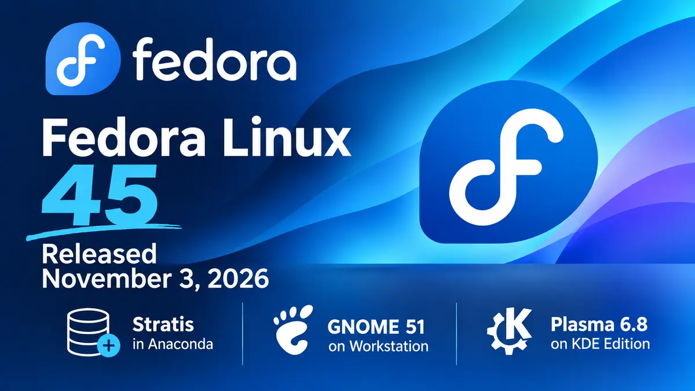

**The** Fedora Project released Fedora Linux 45 on November 3, 2026. The headline change is in the installer: Anaconda can now install Fedora onto Stratis storage. Workstation moves to GNOME 51, and the KDE Plasma Desktop edition ships Plasma 6.8.

Read the notes below before you upgrade. Fedora 45 removes two NetworkManager VPN plugins. It swaps the text console for a new one. It also turns on stricter defaults for RPM signatures and ptrace. Most desktop users will notice little. Admins, developers, and anyone on a Cisco or Fortinet VPN have a few things to check.

Stratis installs are new, so try them on a spare machine first.

## What's new in Fedora Linux 45?

### Installer and Stratis

- **Stratis in Anaconda.** You can install the root and home filesystems on a Stratis pool. Stratis adds pooling, thin provisioning, snapshots, and encryption on top of XFS, device-mapper, and LUKS.
- **Web UI setup.** Guided partitioning does not offer Stratis yet. Open the Cockpit storage module from the installer's manual option. Create /boot and /boot/efi (or biosboot) yourself. Then add a Stratis pool and filesystems.
- **Kickstart support.** Use `autopart --type=stratis`, or build the layout with the new `stratispool` and `stratisfs` commands.
- **Known limits.** Anaconda cannot set up caching or passphrase-free encryption. You can enable both after install. With over-provisioning on, a pool can promise more space than the disk holds, so watch real usage.
- **Atomic Desktops installer.** ISOs for Silverblue, Kinoite, and the other Atomic variants now use the Anaconda Web UI. It allows remote installs from a browser over HTTPS. Image Builder now creates the ISOs, and preview disk images exist for Silverblue and Kinoite. See the [Atomic Desktops notes](https://fedoramagazine.org/whats-new-for-fedora-atomic-desktops-in-fedora-linux-45/) for details.

### Desktops

- **GNOME 51 on Workstation.** Mutter's reworked frame scheduling keeps animations smooth under load. Files shows a count while you drag several items. It no longer freezes on slow directory reloads. Calendar scrolls faster in month view, and the file previewer now uses GTK 4 and libadwaita. Our [GNOME 51 post](https://www.opensourcefeed.org/gnome-51-a-coruna-release/) covers the upstream release.
- **New secrets service.** oo7 replaces GNOME Keyring as the default Secret Service provider on Fedora's GNOME desktops. It stores app passwords and tokens.
- **Plasma 6.8 on the KDE edition.** Highlights include per-screen virtual desktops, a light and dark toggle in the system tray, a microphone test, better remote desktop, and the new Union theming system. Kinoite ships Plasma 6.7 for now. Fedora expects 6.8 to follow soon after release.

### Console and security

- **kmscon replaces fbcon.** Fedora now runs tty1 to tty6 on [kmscon](https://fedoramagazine.org/modernizing-the-console-with-kmscon/). This userspace console has better fonts, Unicode, scrolling, and mouse support. It changes some habits. The `tty` command returns a /dev/pts device. `setfont` and `loadkeys` have no effect, so use `localectl set-keymap`. Graphics programs need `kmscon-launch-gui`. To keep an fbcon console as a fallback, mask `kmsconvt@tty5` and enable `getty@tty5`.
- **Signed packages only.** RPM rejects unsigned packages by default. Pass `--nosignature` to override it.
- **Restricted ptrace.** Unprivileged users can no longer inspect other processes by default. Installing debugging tools restores the old behavior.
- **VPN plugins removed.** NetworkManager-vpnc and NetworkManager-fortisslvpn are gone. They are unmaintained and have published privilege-escalation issues. An upgrade removes them. Move Fortinet SSL VPN profiles to NetworkManager-openconnect. Move Cisco IPsec (IKEv1) profiles to NetworkManager-libreswan.

### Developer tools and system

- **Toolchain.** GCC 16.2, glibc 2.44, binutils 2.47, GDB 17.2, LLVM 23, Go 1.27, Python 3.15, Perl 5.44, and RPM 6.1.
- **Podman 6.** The [new major version](https://fedoraproject.org/wiki/Changes/Podman6) brings breaking API and CLI changes. It drops slirp4netns and the BoltDB backend. Test your scripts before you upgrade container hosts.
- **Database defaults.** The change set lists MySQL 9.7 and MariaDB 12.3 as the new defaults for the unversioned packages.

## Download Fedora Linux 45

Get installation media from [fedoraproject.org](https://fedoraproject.org/). The editions are Workstation, KDE Plasma Desktop, Server, Cloud, CoreOS, and IoT. Atomic Desktops and Spins such as Cinnamon, Xfce, MATE, and COSMIC are also available. Check the download page for verification steps before you write an image to a drive.

Already on Fedora? If you run Fedora 44 ([our release post](https://www.opensourcefeed.org/fedora-linux-44-release/)), upgrade from GNOME Software or run `dnf system-upgrade`. The [offline upgrade guide](https://docs.fedoraproject.org/en-US/quick-docs/upgrading-fedora-offline/) lists the steps. Silverblue users can follow the [rebase guide](https://fedoramagazine.org/how-to-rebase-to-fedora-linux-45-on-silverblue/). Fedora 43 ([release post](https://www.opensourcefeed.org/fedora-linux-43-released/)) reaches end of life in early December, about a month after this release. Plan the move soon.

## References

- [Announcing Fedora Linux 45](https://fedoramagazine.org/announcing-fedora-linux-45/), Fedora Magazine
- [What's New in Fedora Workstation 45](https://fedoramagazine.org/whats-new-fedora-workstation-45/), Fedora Magazine
- [What's New in Fedora KDE Plasma Desktop 45](https://fedoramagazine.org/whats-new-in-fedora-kde-plasma-desktop-45/), Fedora Magazine
- [Installing Fedora 45 on Stratis storage](https://fedoramagazine.org/installing-fedora-45-on-stratis-storage/), Fedora Magazine
- [Migrating away from unmaintained NetworkManager VPN plugins](https://fedoramagazine.org/migrating-away-from-unmaintained-networkmanager-vpnpluginsvpnc-and-fortisslvpn/), Fedora Magazine
- [Fedora 45 change set](https://fedoraproject.org/wiki/Releases/45/ChangeSet), Fedora Project Wiki
- [Fedora Linux 45 Shipping Next Week On 3 November](https://phoronix.com/news/Fedora-45-Ships-Next-Week), Phoronix
