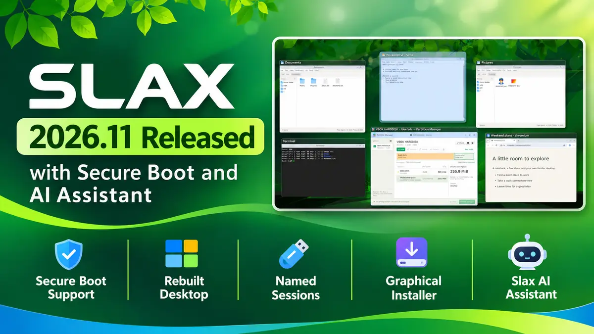

**Tomas Matejicek** released Slax 2026.11 on 8 November 2026. It is the first Slax release in a while, and it rebuilds the desktop, adds Secure Boot support, and ships a graphical installer. The live ISO is based on Debian 13 "trixie" and weighs 512 MiB.

[Slax](/distribution/slax) is a portable Linux you run from a USB stick, so this release matters most to people who carry one for rescue work or daily use. Two changes stand out: you can now boot it with Secure Boot left on, and one stick can hold several named sessions. If you used older Slax versions with `.sb` modules, read the module note below before you switch.

## What's new in Slax 2026.11?

### A rebuilt desktop

- **Window previews:** Alt+Tab shows thumbnails of the windows on the current workspace, and Shift+Tab goes backward.
- **Taskbar previews:** windows from one app share a single icon. Hover over it to see live previews, and drag icons to reorder them.
- **Four workspaces:** Alt+F3 shows all of them at once, and Ctrl+F1 to Ctrl+F4 jump straight to one.
- **Desktop files:** you can keep files and folders on the desktop.
- **Keyboard layouts:** switch from the taskbar indicator, or with Ctrl+Shift, Alt+Shift or Super+Space.
- **Volume:** scroll over the speaker icon or use media keys. Slax remembers the level when you unmute.
- **Fonts:** Chinese and Japanese fonts and colour emoji are included.
- **Consistent look:** apps, old and new, now share one visual style.

### Launcher and apps

- Open the launcher from the green button, the left Super key or Alt+F2, then search or browse by category.
- Optional apps show a small download arrow. One click downloads, installs and opens the app. This needs an internet connection, and `apt` still works if you prefer the terminal.

### Built-in tools

- **Slax AI Assistant:** describe a task or problem in plain language, and it inspects your system and can run commands to fix things. It needs internet access and a sign-in.
- **Partition Manager:** view disk space, then create, resize or format partitions. You can review changes before they apply, and it works offline.

### Boot, sessions and recovery

- **Secure Boot:** Slax uses a signed bootloader and a signed Linux 6.12 kernel, so it can start on compatible PCs without turning Secure Boot off in the firmware.
- **Named sessions:** keep separate sessions for work and for experiments. In the session chooser, press F4 to duplicate a session and F6 to rename it. Duplicate a session before you try something risky.
- **Rescue tools:** LVM, LUKS encryption and XFS tools are included, which helps when you need to check a drive, copy files off it or recover data while the installed system will not start.
- **Virtual machines:** [VirtualBox](/software/virtualbox), [VMware](/software/vmware) and SPICE integration support automatic resizing, clipboard sharing and shared folders, when the host enables them.

### Installer

The new graphical installer runs from Windows or Linux. It can prepare a bootable USB stick or install Slax next to an existing operating system on supported setups. Download the ISO, open it as a folder with a double-click, and launch the installer from the `/slax/` directory.

### Module change to know about

You can still include `.sb` modules before boot. However, `slax activate` and `slax deactivate` do not work in this build, because they depend on AUFS and Slax 2026.11 uses OverlayFS. Installing software with `apt` inside a persistent session still works. If your workflow relies on activating modules on the fly, test the new release before you replace your current stick.

## Download Slax 2026.11

Get the 64-bit ISO from the official site: [slax-2026.11-64bit.iso](https://slax.org/download/slax-2026.11-64bit.iso). The Slax changelog does not list checksums, so verify the download size (512 MiB) and write it to a spare stick first. The Slax site also has a boot and USB guide.

For earlier coverage of the project, see our posts on [Slax 9.11.0](https://www.opensourcefeed.org/slax-9.11.0-release/) and [Slax 9.9.1](https://www.opensourcefeed.org/1-slax-9.9.1-release-screenshot/).

## References

- [Slax 2026.11 is out](https://www.slax.org/blog/49064-Slax-2026.11-is-out.html), official announcement
- [Slax changelog](https://slax.org/changelog.php)
