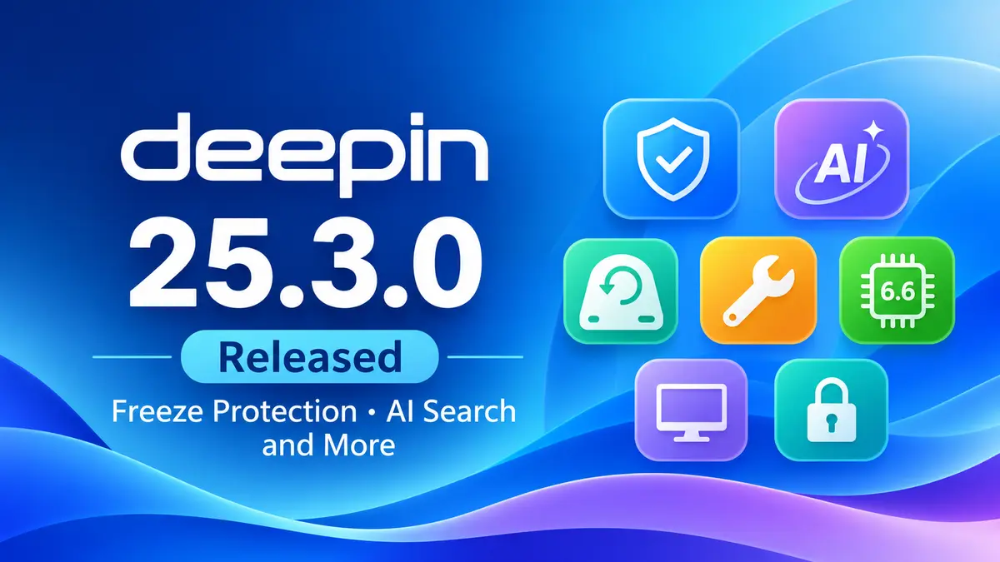

**The** deepin team released deepin 25.3.0 on November 11, 2026. This update focuses on keeping the desktop usable when things go wrong: a new freeze protection feature, easier snapshot recovery, and a default kernel bump to Linux 6.6.159. UOS AI, the built-in assistant, can now search the files on your whole disk.

If you already run deepin 25, this is a worthwhile update. Freeze protection and USB snapshot recovery fix two common pain points on a daily-driver desktop. If you are waiting for newer hardware support, the 6.18.56 kernel is now available in Kernel Manager. This is a point release, so expect refinements rather than a redesign. For context, see our coverage of the [deepin 25.2.0 release](https://www.opensourcefeed.org/deepin-25-2-0-release/) and [deepin 25.1.0](https://www.opensourcefeed.org/deepin-25-1-0-release/).

## What's new in deepin 25.3.0?

### Stability and recovery

- **Freeze protection:** when the system stalls badly, you can still open the taskbar, Launcher and System Monitor, then close the app that caused the problem.
- **Faster Control Center:** the home page loads much faster, and common office apps start quicker under heavy load.
- **Log size limit:** system logs stop at 5 GB by default, and logging halts when free disk space drops below 5%. This keeps logs from filling a small system drive.
- **Snapshots to external drives:** the Immutable System can save snapshots to a local disk, USB drive or portable hard drive. You can also start a restore from the location you pick, so a snapshot on a USB drive stays useful.
- **Lighter upgrades:** the backup and rollback step before an upgrade now uses less extra disk space.

### UOS AI

- **Whole-disk knowledge base:** ask questions about the content of local files you have authorized.
- **Scheduled tasks in plain language:** create reminders and recurring tasks by describing them.
- **One entry point for MCP, Skills and agents:** UOS AI picks the capability a task needs. Conversations get better memory and automatic summaries, and permission modes apply per conversation, so you approve file saves less often.

### Desktop and apps

Application updates arrive through the App Store.

- **Taskbar:** hover over a connected device to disconnect Wi-Fi or Bluetooth quickly. The shutdown animation now plays for the whole shutdown, so a short black screen no longer looks like a failure.
- **PC Manager:** now in the default image. It runs system, hardware and network checks, cleans disks, finds large and duplicate files, manages startup apps and offers common fixes.
- **Image Viewer:** crop, rotate, draw with markup tools, add text, and apply mosaic or blur without leaving the viewer.
- **Document Viewer:** reopens at your last reading position and adds Classic, Green and Night eye-care modes.
- **Text Editor and Calendar:** the editor renders Markdown, and the calendar accepts third-party schedules.
- **App Store:** adds proxy settings and shows install error details with help links in Notification Center.

### Kernel, graphics and hardware

- **Kernel 6.6.159 by default:** fixes security issues on x86, arm64 and loong64 and resolves boot problems on some devices.
- **Kernel 6.18.56 on request:** install it from Kernel Manager if your hardware needs newer support.
- **GPU acceleration for Linyaps containers:** the NVIDIA container toolkit comes preinstalled, so Linyaps apps can use the GPU for video and graphics.
- **Driver updates:** GPU drivers gain CDI support, the integrated GPU driver is newer, and the installer now picks a matching NVIDIA driver for your card.
- **Intel microcode:** updated files restore Meteor Lake mitigations and fix fatal MCE errors.

### Treeland and security

Treeland, the deepin Wayland compositor, gets protocol changes that the team plans to keep stable and compatible going forward, plus Xwayland fixes for X11 apps and a login screen that stays readable on light wallpapers. The release also patches many components, including Qt, curl, FFmpeg, glibc, OpenVPN, BlueZ and nginx. The full bug fix list is long, so check the official notes for fixes in your own workflow.

### Known issues

The team lists three minor issues: wrong text styling in Launcher group folders, memory growth in Image Viewer when you zoom with the scroll wheel, and the Launcher window showing in Multitasking View if you open it after the Launcher.

## Download deepin 25.3.0

ISO images are available for AMD64, ARM64 and Loong64. RISC-V is marked as a technology preview. Get them from the [official deepin download page](https://www.deepin.org/en/download/), which links the official mirror, BitTorrent, SourceForge and other mirrors. The page also provides SHA256 checksum files, so verify your ISO before you write it to a USB drive. For background on the Immutable System that these snapshot changes build on, read our [deepin 25 release story](https://www.opensourcefeed.org/deepin-25-released/).

## References

- [deepin 25.3.0 Release Note (deepin.org)](https://www.deepin.org/en/deepin-25-3-release/)
- [Download deepin (deepin.org)](https://www.deepin.org/en/download/)
- [Distribution Release: deepin 25.3.0 (DistroWatch)](https://distrowatch.com/?newsid=13036)
- [Deepin 25.3 Adds Freeze Protection, AI Improvements, and Better Recovery (Linuxiac)](https://linuxiac.com/deepin-25-3-adds-freeze-protection-ai-improvements-and-better-recovery/)
