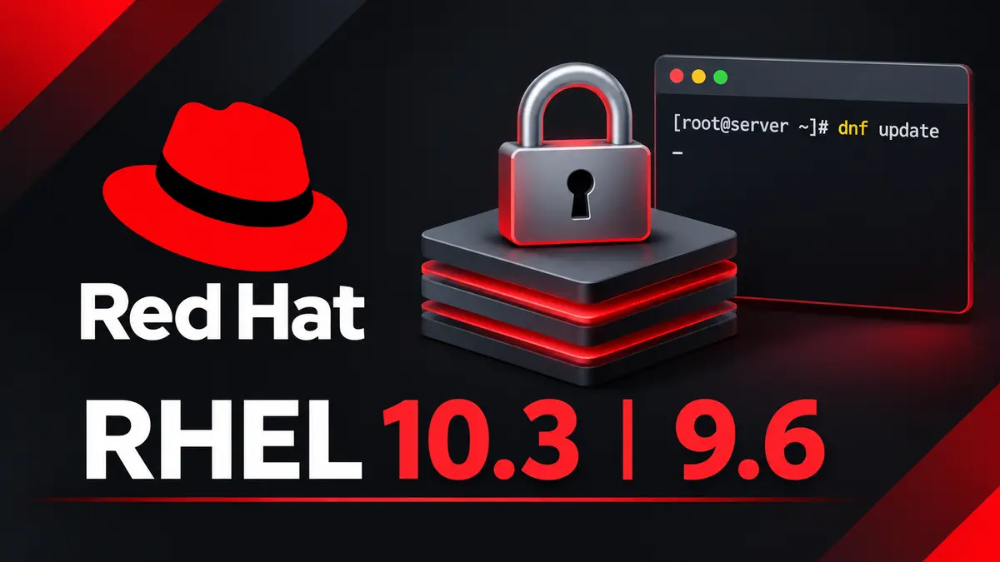

**Red Hat** released RHEL 10.3 and RHEL 9.9 on November 11, 2026. The main feature is sealed images for image mode, which reach general availability in RHEL 10.3. Both releases ship a production-ready MCP server and newer developer toolsets. Red Hat also supports Leapp upgrades from 8.10 to 9.9 and from 9.9 to 10.3.

If you run image mode on RHEL 10, sealed images are the reason to update. If you run RHEL 9, 9.9 is a routine minor update with newer tools. Red Hat's announcement names no features that are exclusive to 9.9. Teams on RHEL 8.10 now have a supported route to 9.9, so that is the step to plan. Red Hat shipped the [RHEL 10.2 and 9.8 release](/rhel-10-2-and-9-8-release/) in May, so this follows the usual six-month cadence.

## What's new in RHEL 10.3 and 9.9?

Unless noted, the items below ship in both releases.

### Security

- **Sealed images for image mode (10.3).** You sign the OS with your own Secure Boot keys. The chain of trust runs from firmware and bootloader through the kernel to the root filesystem. The root filesystem is read-only, and the kernel refuses tampered content when it reads it. This suits zero trust designs and compliance work in finance, healthcare and government.
- **Post-quantum cryptography.** Red Hat adds features to help regulated customers meet CNSA 2.0 requirements. RHEL 10.3 adds native post-quantum support to the Go toolchain, so Go programs can use these algorithms.
- **Tighter IMA checks (10.3).** Modified programs on filesystems that IMA used to skip can no longer bypass integrity checks, according to Linuxiac.

### AI-assisted administration

- **MCP server for RHEL is GA.** It leaves Developer Preview and installs as an RPM from the RHEL extensions repository. An AI assistant can use it to read system data for diagnostics. It can query historical Performance Co-Pilot (PCP) data to trace problems that come and go. It works with goose, Red Hat's open source AI command-line agent.
- **Self-managed command-line assistant (Developer Preview).** You can run the assistant on your own inference hosting. Prompts stay inside air-gapped or disconnected networks. The hosted option remains for connected systems.
- **New AI dashboards for grafana-pcp.** They show GPU, CPU and network data in one view, which helps teams that run AI and machine learning workloads.

### Developer tools

- **Compilers and runtimes.** GCC 16, LLVM 22, Go 1.27, Rust 1.97, .NET 11, Node.js 26 (LTS) and PHP 8.4. Linuxiac reports that GCC 16 defaults to C++20, up from C++17, so check your builds. Red Hat does not say which versions ship in which release, so read the notes for your branch.
- **RHEL image builder CLI is GA.** You can build custom OS disks and bootable container images from config files in CI pipelines.

### Under the hood (10.3)

- **Kernel 6.12**, with Red Hat patches and backports.
- **Valkey 8.1**, with an optional `valkey-rdma` module for RDMA support.

### Upgrade paths

Red Hat supports in-place Leapp upgrades from RHEL 9.9 to RHEL 10.3 and from RHEL 8.10 to RHEL 9.9. Test the upgrade on a copy of your system first. Read the in-place upgrade section of the release notes before you start.

## Download RHEL 10.3 and 9.9

Customers with an active subscription can get both releases from the [Red Hat Customer Portal](https://access.redhat.com/downloads/content/479). If you have no subscription, Red Hat offers a [60-day trial of RHEL 10.3](https://www.redhat.com/en/products/trials#rhel).

## References

- [Red Hat press release: Red Hat Strengthens Hybrid Cloud Foundations Against AI-Driven Threats](https://www.redhat.com/en/about/press-releases/red-hat-strengthens-hybrid-cloud-foundations-against-ai-driven-threats-latest-versions-red-hat-enterprise-linux)
- [Introducing Red Hat Enterprise Linux 10.3 and 9.9 (Red Hat blog)](https://www.redhat.com/en/blog/introducing-red-hat-enterprise-linux-103-and-99)
- [What's new for developers in RHEL 10.3 and 9.9 (Red Hat Developer)](https://developers.redhat.com/articles/2026/11/11/new-for-developers-in-rhel-10-3-and-9-9)
- [RHEL 10.3 release notes](https://docs.redhat.com/en/documentation/red_hat_enterprise_linux/10/html/10.3_release_notes/overview)
- [RHEL 9.9 release notes](https://docs.redhat.com/en/documentation/red_hat_enterprise_linux/9/html/9.9_release_notes)
- [RHEL 10.3 Released with Linux Kernel 6.12, GCC 16, and Sealed Images (Linuxiac)](https://linuxiac.com/rhel-10-3-released-with-linux-kernel-6-12-gcc-16-and-sealed-images/)
