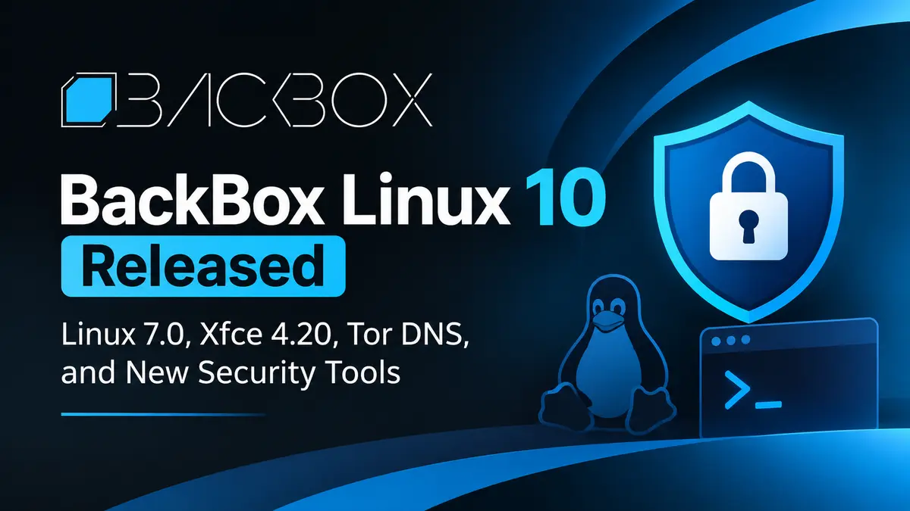

**The** BackBox team has released BackBox Linux 10, codename "Resolute Raccoon", on November 19, 2026. The penetration testing distribution is built for compatibility with Ubuntu 26.04 LTS. It ships Linux 7.0 and Xfce 4.20, adds a batch of new security tools, and changes how its anonymous mode handles DNS and IPv6.

BackBox Linux 10 follows [version 9, released in October 2024](https://blog.backbox.org/2024/10/30/backbox-linux-9-released/). If you run a security lab, the anonymous mode change is the part to read first. A DNS lookup or an IPv6 packet that skips Tor can reveal which hosts you plan to contact, even when the rest of your traffic stays hidden. Version 10 closes both gaps. If you relied on anonymous mode in an older release, test your setup for stray DNS and IPv6 traffic before you trust it again. If you also test with Kali Linux, our [Kali Linux 2024.3 release report](https://www.opensourcefeed.org/kali-linux-20243-release/) shows how another security distribution handles its tool updates.

## What's new in BackBox Linux 10?

### Base system

- **Linux kernel 7.0.** Ubuntu 26.04 LTS ships the same kernel series, which keeps BackBox close to its Ubuntu base.
- **Xfce 4.20.** The default desktop stays light and gets a version bump.

### Updated tools

The tool repository moves to current versions of the programs most testers use every day:

- Metasploit Framework 6.5
- Nmap 7.98
- Wireshark 4.6
- sqlmap 1.10
- hashcat 7.1
- ZAP 2.17

### New tools

The new additions focus on web testing, bug hunting and Windows networks:

- **ffuf and gobuster** search a website for hidden pages and directories.
- **AFL++** is a fuzzer. It feeds malformed input to a program until something breaks.
- **GDB, LLDB, ltrace and checksec** cover binary analysis.
- **smbclient, plus Kerberos and LDAP clients,** help when you test Windows and Active Directory networks.
- **hashID, mdk4, Firejail, apksigner and aapt** round out hash identification, wireless testing, sandboxing and Android APK work.

### Anonymous mode

- DNS queries now go through Tor as well.
- IPv6 is blocked while anonymous mode is on, so packets cannot bypass the tunnel.
- The `anonymous stop` command restores your original network settings when you finish.

### Installer and virtual machines

- The installer offers normal and minimal installations, full disk encryption (LVM on LUKS) and ZFS support.
- The ISO is a hybrid image with UEFI and Secure Boot support.
- On VMware, the live session includes open-vm-tools, and the desktop resizes to follow the VMware window.

## Download BackBox Linux 10

The 64-bit ISO is available, directly or via torrent, from the [official BackBox download page](https://linux.backbox.org/download/). The announcement does not describe an upgrade path from version 9, so back up your data and plan a fresh install.

System requirements:

- 64-bit processor
- 2 GB of RAM
- 30 GB of disk space
- A graphics card that supports 800×600 resolution
- A USB port and a USB drive of 8 GB or more

The team also says it is working on integrating agentic cyber operations into the distribution through its new BackBox AI technology. BackBox remains a free, community-driven project, and you can support it with a donation from the download page.

## References

- [BackBox Linux 10 released (official announcement)](https://blog.backbox.org/2026/11/19/backbox-linux-10-released/)
- [BackBox download page](https://linux.backbox.org/download/)
- [Help Net Security: BackBox Linux 10 brings new hacking tools and Ubuntu 26.04 support](https://www.helpnetsecurity.com/2026/11/19/backbox-linux-10-penetration-testing/)
- [Canonical: Ubuntu 26.04 LTS ships with the final 7.0 Linux kernel](https://discourse.ubuntu.com/t/26-04-lts-resolute-raccoon-shipping-with-the-final-7-0-linux-kernel/80838)
- [BackBox Linux 9 released (previous major release)](https://blog.backbox.org/2024/10/30/backbox-linux-9-released/)
