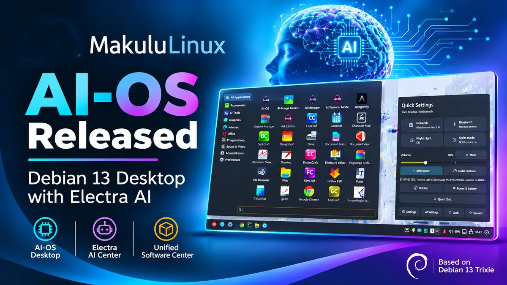

**MakuluLinux** has released AI-OS, a new Debian-based Linux distribution that integrates artificial intelligence into its desktop experience. Released on November 19, 2026, the first public edition combines the custom AI-OS Desktop with Electra AI Center in a single live and installable ISO.

The release introduces a redesigned desktop based on the Cinnamon 6.x codebase, new window management options, visual effects, and a unified software center. It also provides several ways to access AI assistance, including desktop shortcuts, a graphical workspace, and a terminal interface.

## AI-OS Desktop

AI-OS Desktop is a heavily modified fork of the Cinnamon 6.x codebase. MakuluLinux has reworked several desktop components, including the shell, session manager, settings daemon, and control centre.

The desktop uses Muffin for window management and compositing, while Nemo handles file management.

One of the main additions is Appearance Studio, which brings several customisation options together. Users can manage light and dark styles, accent colours, transparency, rounded corners, shadows, icon themes, and pointer themes.

The desktop also offers three panel layouts: Classic, Floating, and Compact.

Other desktop features include:

- **Automatic window tiling:** Arrange windows automatically with configurable gaps and drag-to-swap controls.
- **Wobbly Windows:** Add adjustable movement effects when maximising and unmaximising windows.
- **Desktop animations:** Choose from Magic Lamp, Desktop Cube, and 16 window-closing animations.
- **Flexible file manager:** Switch between Classic, Modern, Minimal, and Explorer layouts while retaining Nemo features such as tabs, dual panes, and file actions.

Users can adjust or disable visual effects through the desktop settings.

## Electra AI Center

Electra AI Center is a separate application included in the AI-OS installation image. It provides a graphical workspace and terminal interface for AI-assisted tasks such as writing, research, coding, and system help.

The desktop integrates several entry points to the assistant.

Quick Chat allows users to ask questions without opening the full application. The floating Electra Bar provides another shortcut, while supported file actions allow users to hand files directly to Electra for assistance.

The assistant can also route requests to tools and models suited to different tasks.

However, AI functionality is not mandatory for using the desktop. Standard features such as panels, window management, and file browsing work without an Electra account.

Hosted AI features require an internet connection. Model availability and usage limits depend on the user's account or plan.

## Unified Software Center

MakuluLinux has introduced a dedicated software center that brings three application formats into one interface:

- APT packages
- Flatpak applications
- Snap packages

When an application is available through multiple formats, users can select their preferred source.

The available application catalogue depends on the repositories and services configured on the system. The software center aims to make application discovery and installation easier without requiring users to manage separate package management interfaces.

## Additional Desktop Tools

AI-OS also includes several utilities for everyday desktop management.

These include Quick Settings, a desktop dashboard, Task Manager, Update Manager, and a built-in Release Notes viewer.

Together with Appearance Studio and the redesigned software center, these additions provide a more integrated desktop experience.

## Debian 13 Base and System Requirements

MakuluLinux AI-OS is based on Debian 13 Trixie and targets 64-bit x86 systems. The release uses the Linux 6.19.14 kernel series.

MakuluLinux recommends the following hardware for a comfortable desktop experience:

- **Processor:** Quad-core CPU, roughly equivalent to a sixth- or seventh-generation Intel Core processor or newer, or an equivalent AMD processor.
- **Memory:** 8 GB RAM or more.
- **Graphics:** Hardware-accelerated graphics.

These recommendations are particularly relevant for users who want to run the desktop's visual effects. Actual performance depends on the processor, graphics hardware, and driver support.

X11 is the recommended session for this release. Wayland support remains limited and is still under development.

## Download MakuluLinux AI-OS

The first public release is available as a live and installable ISO.

**Release details:**

| Specification | Details |
|---|---|
| Distribution | MakuluLinux AI-OS |
| Release date | November 19, 2026 |
| Base | Debian 13 Trixie |
| Architecture | 64-bit x86 (amd64) |
| Kernel | Linux 6.19.14 series |
| Desktop | AI-OS Desktop |
| Desktop foundation | Cinnamon 6.x codebase |
| Recommended RAM | 8 GB or more |

**ISO filename:** `MakuluLinux-AI-OS-Debian-2026-11-19.iso`

**SHA-256 checksum:**

`aeb4559784a5208a5519a83f9008c9ed08b764a2f545d0acfd296e58f8bc343f`

Download the ISO and find additional information through the official resources:

- [Download MakuluLinux AI-OS](https://makululinux.us/members/downloads/)
- [Official release announcement](https://makululinux.us/members/makululinux-ai-os-desktop-is-live/)
- [MakuluLinux website](https://makululinux.com)
- [MakuluLinux Telegram channel](https://t.me/makululinux)