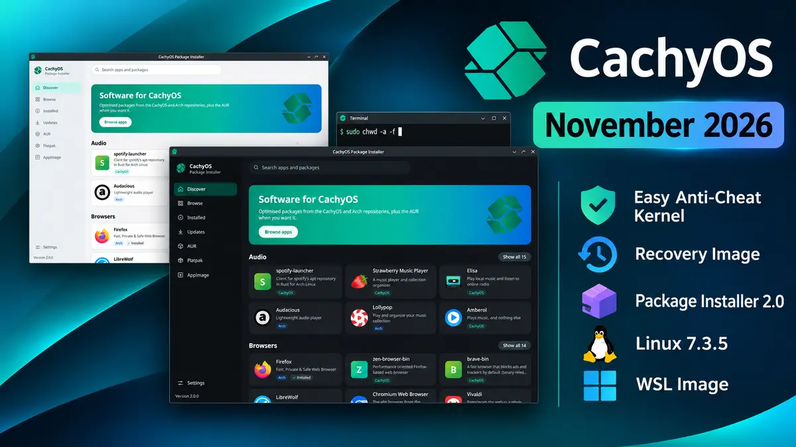

**The** CachyOS November 2026 release is out as ISO 261122, dated November 22. It is the sixth release this year. The big items are an optional kernel for Easy Anti-Cheat Linux v2, a recovery image that can roll back Btrfs snapshots without a live USB, and a rebuilt Package Installer 2.0. The ISO ships Linux 7.3.5 with the 6.18.64 LTS kernel as an alternative.



If you already run CachyOS, update first and then run one extra command to reinstall driver profiles. If you play games that use Easy Anti-Cheat, read the requirements before you try the new kernel. It needs Secure Boot, a TPM 2.0 and a locked-down kernel, which is a bigger change than a normal kernel swap.

## What's new in CachyOS 261122?

### Easy Anti-Cheat kernel

- A new `linux-cachyos-eac` kernel, signed with the CachyOS key, gets its own boot entry. Your normal kernels stay in the boot menu.
- EAC Linux v2 needs Secure Boot, TPM 2.0, an enabled IOMMU and a kernel in lockdown mode that loads only signed modules.
- DKMS modules do not work on this kernel, so NVIDIA (open and 580xx), ZFS and r8125 ship as `linux-cachyos-eac-*` packages.
- New `eac-setup` and `eac-status` scripts in cachyos-settings handle setup on systemd-boot, Limine and rEFInd, with experimental GRUB support.
- CachyOS asks you to read the wiki guide first, especially if you use BitLocker or TPM disk unlock.

A caveat: while the kernel was still in development, [PC Games Hardware reported](https://www.pcgameshardware.de/Linux-Software-26761/News/CachyOS-EAC-Kernel-Easy-Anti-Cheat-Linux-v2-Secure-Boot-1558229/) that Epic's list of trusted signing keys did not yet include CachyOS. Whether a protected game starts depends on Epic and on the game's publisher, not only on the kernel.

### Recovery and boot

- **cachyos-recovery** is a new, self-contained recovery image. You can boot it from the bootloader or straight from UEFI, so you do not need a live USB.
- It can boot any Btrfs snapshot with a writable root, so you can test a snapshot before you commit. A desktop notification or the recovery menu then makes the rollback permanent.
- A rollback rebuilds the kernel, initramfs and bootloader config, and signs them if you set up sbctl. It works without Snapper, supports LUKS and uses about 70 MB on the ESP.
- Install it with `sudo pacman -S cachyos-recovery`, or `cachyos-recovery-legacy` on BIOS systems.
- **cachyos-drm-awaiter** replaces early KMS and `nvidia-module-loader`. It waits for the GPU driver, from any vendor, before the display manager starts. It shows a QR code if a driver fails to load.

### Package Installer 2.0

- A full UI redesign, with a settings page for colour themes and a button that ranks mirrors.
- AUR support is opt-in. It handles updates for installed AUR packages and shows a diff against the installed version during review.
- Before a build, it shows the PKGBUILD and install scripts, and static analysis flags suspicious lines.
- Flatpak and AppImage support are also opt-in. AppImages can come from a local file or a GitHub project URL, with update tracking, and it can take over AppImages you added through Shelly or Gear Lever.

### Installers

- Calamares uses the shared gucc libraries and defaults the root partition to the `SD_GPT_ROOT_X86_64` type. Plymouth is now optional, and the `kms` hook no longer goes into the initramfs by default.
- Calamares drops the rEFInd + AI SDK bootloader option. You can add it later with `chwd -a --ai_sdk`.
- The CLI installer got a large refactor, better LUKS and LVM bootloader handling, LUKS passphrase and keymap options, and username and hostname checks. It also dropped the `EraseAndAuto` layout.

### Kernel, drivers and packages

- Linux 7.3.5 and LTS 6.18.64, with Rust support, ThinLTO and Rust Binder enabled.
- NVIDIA 620.73.04, Mesa 26.3.1 and Limine 12.10.0.
- proton-cachyos 11.0-20261015. The native variant is now wow64-only.
- mutter ships with tearing patches merged. A nvidia-580xx-utils fix stops a plasmashell crash by using egl-wayland2 on KWin.
- systemd-oomd is back and on by default, and it kills based on swap use. REISUB is enabled by default.
- CachyOS now offers a WSL image for Windows users.

### Smaller changes

- chwd adds Framework Laptop 12 tablet mode support and detects Wildcat Lake CPUs. It drops the nvidia-dkms-470xx profile.
- The Hyprland and Mango Noctalia desktops got new keybinds and plugins, and a repo-only `cachyos-jay-noctalia` package covers the Jay compositor.
- New mirrors in South Korea, India, Switzerland and the US East coast.

You can read the full list of fixes in the [official announcement](https://cachyos.org/blog/2611-november-release/).

## Download CachyOS 261122

Get the desktop ISO from the [official CDN](https://iso.cachyos.org/desktop/261122/cachyos-desktop-linux-261122.iso). The announcement also lists mirrors in Germany, Sweden, the US and elsewhere, plus a [SourceForge page](https://sourceforge.net/projects/cachyos-arch/files). It does not list checksums, so compare the file against the values on the official download page before you write it to a drive.

Existing users do not need to reinstall. Because cachyos-drm-awaiter replaces early KMS, update and then reinstall your driver profiles:

```
sudo pacman -Syu
sudo chwd -a -f
```

For more on how this release follows the last one, see our notes on the [CachyOS August 2026 release](/cachyos-august-2026-release/). All our CachyOS coverage is on the [CachyOS distribution page](/distribution/cachyos).

## References

- [CachyOS November 2026 Release announcement](https://cachyos.org/blog/2611-november-release/)
- [CachyOS: Optionaler Linux-Kernel für Easy Anti-Cheat und Fortnite](https://www.pcgameshardware.de/Linux-Software-26761/News/CachyOS-EAC-Kernel-Easy-Anti-Cheat-Linux-v2-Secure-Boot-1558229/), PC Games Hardware
- [CachyOS Linux working on a dedicated kernel for supporting Easy Anti-Cheat v2](https://www.gamingonlinux.com/2026/10/cachyos-linux-working-on-a-dedicated-kernel-for-supporting-easy-anti-cheat-v2/), GamingOnLinux
- [CachyOS announces Package Installer 2.0 to simplify app management](https://www.kitguru.net/?p=751834), KitGuru
