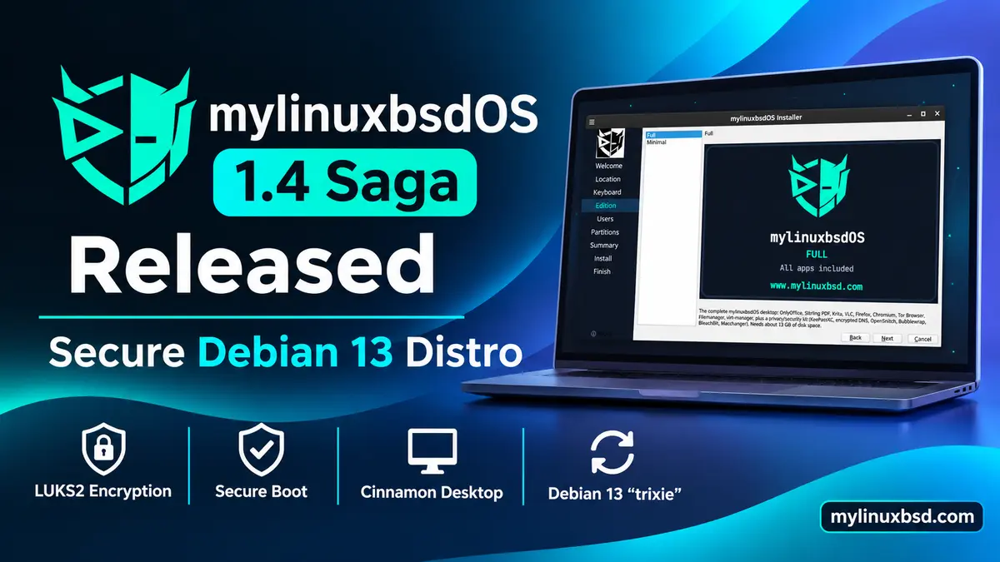

**myLinuxBSD**, a team based in Cyberjaya, Malaysia, released mylinuxbsdOS 1.4 "Saga" on 18 November 2026. It is a free distribution built on Debian 13 "trixie", with Linux 6.12 and systemd. One installer gives you a choice of a Cinnamon desktop with a privacy toolkit, or a command-line server base.



Despite the name, this is a Linux distribution. It does not use a BSD kernel. Its focus is security defaults: you can turn on full-disk encryption during install, and Secure Boot works out of the box. If you want a Debian-based system that is hardened from the first boot, and you do not want to assemble the pieces yourself, it is worth a look. Because it is a young project, test it in a virtual machine before you put it on your main laptop.

## What's new in mylinuxbsdOS 1.4?

### Two editions, one installer

- **Full:** a Cinnamon desktop for daily use. It includes OnlyOffice, Stirling PDF, Krita, VLC, Firefox, Chromium, Tor Browser and virt-manager.
- **Privacy toolkit (Full):** KeePassXC for passwords, OpenSnitch as an application firewall, Bubblewrap for app sandboxing, BleachBit for cleanup, Macchanger for MAC address changes and encrypted DNS support.
- **Minimal:** a text-only base for servers and small systems. The project lists ufw, AppArmor, kernel hardening and automatic security updates as part of it.

You pick the edition in the Calamares installer. Per the project documentation, Full takes about 13 GB once installed and Minimal about 3 GB.

### Security defaults

- **Optional LUKS2 full-disk encryption** from the installer. The documentation warns that a lost passphrase cannot be recovered, so store it somewhere safe.
- **UEFI Secure Boot** and legacy BIOS support. The documentation notes that BIOS-mode installs are untested, while the live session does boot in BIOS mode.
- **`mylinuxbsd-security`**, a built-in command that checks the system's security posture.

### Convert an existing Debian 13 server

A migration script turns an existing Debian 13 server into mylinuxbsdOS Minimal without a reinstall. The project says it backs up every file it changes and can be undone. That is useful if you want the hardening on a server you already run. The documentation says the script was tested on Debian 13 containers and one BIOS virtual machine, so try it on a test box first.

### Try it in your browser

The project offers a 15-minute browser session of the real system, in Full or Minimal. If you boot the live ISO instead, the live login is `mylinuxbsd` with the password `mylinuxbsd`.

## Download mylinuxbsdOS 1.4

The ISO is about 3 GB and is available on the [project's SourceForge page](https://sourceforge.net/projects/mylinuxbsdos/). The [official download page](https://www.mylinuxbsd.com/download.html) links to it as well.

The project published this SHA256 checksum for the 1.4 ISO in its announcement:

```
daf1e14d4f7588f16e2377e873ff4f66cf3f439f1fb9e643d6d1d3a9068f6b55
```

Check the file before you write it to a USB drive:

```
sha256sum mylinuxbsdOS-1.4.iso
```

System requirements from the documentation: a 64-bit PC, 4 GB of RAM or more, and at least 15 GB of free disk space. SourceForge lists the project under the Apache License 2.0. The build system and source code are on [GitHub](https://github.com/mylinuxbsd-lab/mylinuxbsdOS).

If you want a comparison, our coverage of [Debian 13 "trixie"](https://www.opensourcefeed.org/debian-13-trixie-released/) explains the base system. For another privacy-focused option, see [Tails 7.0](https://www.opensourcefeed.org/tails-7-0-released/). If the Cinnamon desktop is what interests you, read about [Linux Mint 22.2](https://www.opensourcefeed.org/linux-mint-22-2-zara-release/).


## mylinuxbsdOS 1.4 screenshots.

> Screenshot courtesy: mylinuxbsdOS project.



## References

- [myLinuxBSD official website](https://www.mylinuxbsd.com/index.html)
- [mylinuxbsdOS download page](https://www.mylinuxbsd.com/download.html)
- [mylinuxbsdOS documentation](https://www.mylinuxbsd.com/docs.html)
- [mylinuxbsdOS on SourceForge](https://sourceforge.net/projects/mylinuxbsdos/)
