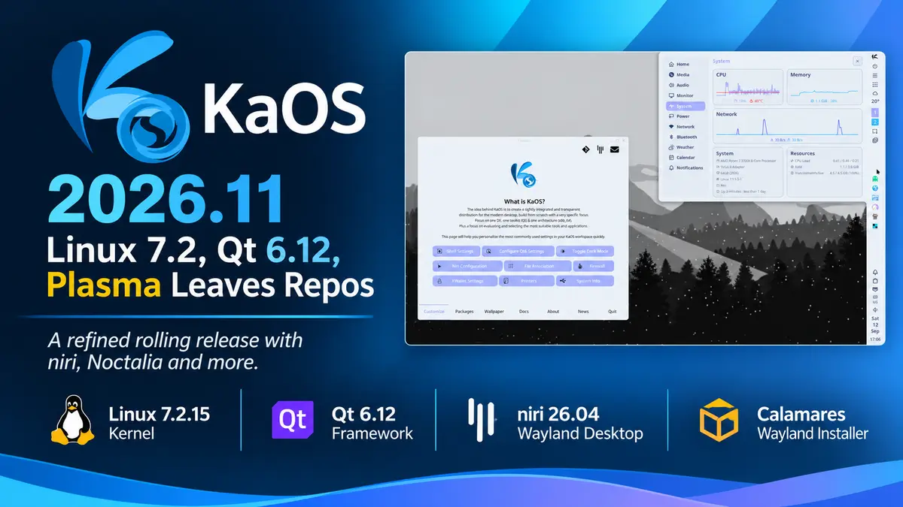

**KaOS** has released its November ISO, KaOS 2026.11, on 22 November 2026. The snapshot ships Linux 7.2.15 and Qt 6.12 on the niri and Noctalia desktop, and it finishes a move the team announced earlier this year: the Plasma desktop packages are now gone from the KaOS repositories.

## What's new in KaOS 2026.11?

### Desktop

- **niri 26.04 with Noctalia 5.6.0.** The shell has been rewritten to run directly on Wayland and OpenGL ES. The release notes also list a screenshot region editor with annotation tools, mobile data controls with signal display through ModemManager, and collapsible settings cards. Plugins are available too.
- **Plasma desktop removed from the repositories.** Plasma 6.8 is out, and KaOS no longer packages the desktop. The Plasma libraries that KDE applications need, such as libplasma, stay.
- **Qt 6.12.0, KDE Frameworks 6.32.0 and KDE Applications 26.08.3.** Qt5 is gone, because the last apps that needed it moved to Qt6.
- **Helper tools** for the niri session include cliphist, brightnessctl, ddcutil, pavucontrol-qt, qt6ct and xwayland-satellite.

### Init, login and services

- **dinit, turnstile and seatd** handle init and sessions. systemd use shrinks again and stays only for udev and tmpfiles.
- **elogind stays only to provide a working polkit.** It no longer handles system login.
- **Locale, time and timesync services are back as standalone parts** through openrc-settingsd, with a console-setup-based replacement for localectl.
- **greetd with the Tuigreet console greeter** is the default login screen. A graphical option, noctalia-greeter, is in the repositories but is less complete.

### Installer

- **Calamares now runs on a pure Wayland system.** A text-input fix in the QML pages means user creation works.
- **Limine is the default bootloader.** Other UEFI options remain, but systemd-boot is no longer offered.
- **Automated partitioning covers XFS, EXT4, BTRFS and ZFS.** XFS, with CRC and finobt enabled, is the default filesystem.

### New apps and packages

- **Croeso** is a new QML setup app that runs after installation. It covers about 15 common settings, a wallpaper picker, system info and six package groups.
- **kss** is a simple GUI for KDE application settings, and **kwi** is an early-stage KDE terminal built with Zig and libghostty.
- **dex** adds XDG autostart support on the non-systemd setup.
- **android-tools** returns after an absence of six to seven years.
- **Microcode updates** are built into the kernel, so CPUs get early updates without extra setup.
- **A new icon theme for light themes** keeps the Midna look consistent from boot to logout.
- **Notable versions:** Mesa 26.3.1, PipeWire 1.6.11, Python 3.14.10, Rust 1.100, LLVM/Clang 23.1.5, ZFS 2.4.4, OpenSSH 10.5, CMake 4.5, Boost 1.92.0, Pacman 7.1.0 and Dinit 0.23.0.

## Known issues

Check these before you install:

- Installing on RAID is not possible.
- On BIOS systems, XFS does not work, because GRUB fails to install with the latest XFS.
- In VirtualBox, KaOS boots only with 3D acceleration on and the VMSVGA adapter, since Wayland needs it.
- Polkit is not fully ported to turnstile and seatd, so some privilege escalation options will not work.

## Download KaOS 2026.11

Get the ISO from the [official KaOS download page](https://kaosx.us/download/). The project offers GPG signature checks for its ISOs, and the announcement does not list checksums, so verify the file with the instructions on that page. The team advises against writing the ISO with Unetbootin, Ventoy or Rufus, and says to burn DVDs at 4x or slower.

KaOS is a rolling release, so an ISO is a snapshot and installed systems update through the package manager. The release notes give no migration steps for older installs. If you still run Plasma or a systemd-based setup, read the [systemd and Plasma article](https://kaosx.us/news/2026/systemd_kaos/) and ask on the [KaOS forum](https://forum.kaosx.us/) before a full update. For earlier coverage, see our [KaOS archive](/distribution/kaos).

## References

- [KaOS 2026.11 release announcement](https://kaosx.us/news/2026/kaos11/)
- [Systemd and the future of KaOS](https://kaosx.us/news/2026/systemd_kaos/)
- [KaOS download page](https://kaosx.us/download/)
- [Linuxiac: KaOS 2026.09 released with Dinit, Niri, and Noctalia 5.1](https://linuxiac.com/kaos-2026-09-released-with-dinit-niri-and-noctalia-5-1/)
- [Linux Today: KaOS Linux 2026.06 launches as first release with Dinit](https://www.linuxtoday.com/blog/kaos-linux-2026-06-launches-officially-as-first-release-with-dinit/)
