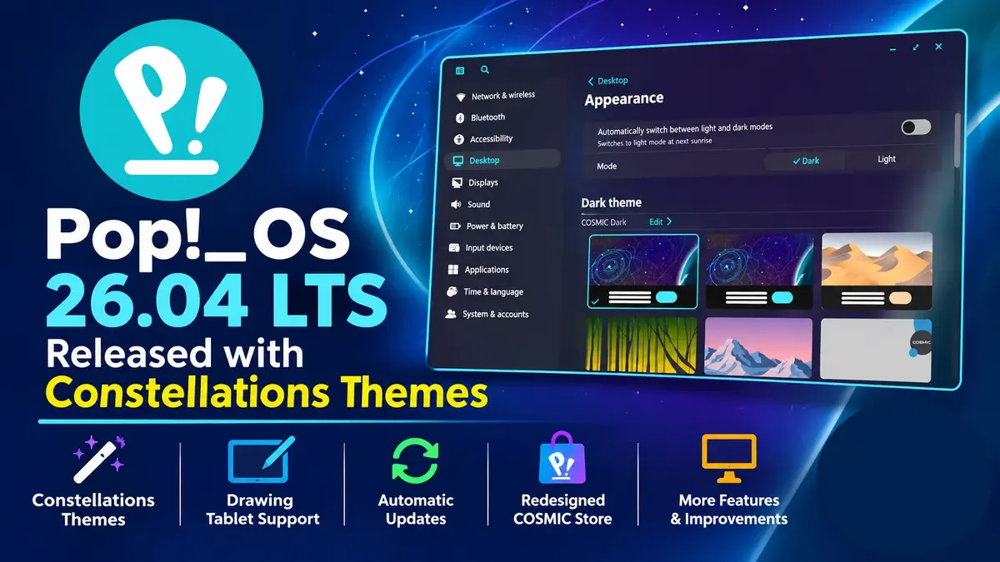

**System76** released Pop!_OS 26.04 LTS on 24 November 2026. The headline feature is Constellations, a one-click theme system for the [COSMIC desktop](/desktop/cosmic). The release also adds drawing tablet support, optional automatic updates and a redesigned COSMIC Store.

If you already run Pop!_OS 24.04 LTS, much of this will look familiar. COSMIC is a rolling release desktop, so System76 has been shipping many of these features through regular updates. The upgrade from 24.04 to 26.04 will be switched on in December. Until then, a fresh install is the way to get the full 26.04 experience, so back up your files first. The release is built on [Ubuntu 26.04 LTS](/ubuntu-26-04-resolute-raccoon-release/).

## What's new in Pop!_OS 26.04 LTS?

### Constellations: change the whole look in one click

Constellations are bundled themes for COSMIC. Each one sets the wallpaper, accent colors, icons and fonts together. Before, that meant visiting several settings pages. Now you open Settings > Desktop > Appearance, pick dark or light mode, choose whether the mode switches automatically, and select a theme.

- Apply a Frosted Glass effect on top of any Constellation.
- Edit nearly every part of a Constellation to suit your taste.
- Export your finished Constellation as a backup or to share with others.

### Input and hardware

- **Drawing tablet support:** pen input with tilt sensitivity, which makes the desktop usable for graphic design, photo editing, animation, note-taking, CAD and GIS work.
- **On-screen keyboard:** works with touch and gamepad input, useful for tablets and handheld setups.
- **Hybrid GPU laptops:** better automatic GPU selection when a system has two graphics chips.

### System and updates

- **Automatic updates:** turn them on during first setup or later under Settings > System & accounts > System & application updates. Fewer missed security fixes.
- **Remote desktop support** is now built in.
- **Workspace wrapping:** you can now configure whether workspaces wrap around when you switch past the last one.

### Native apps

- **COSMIC Viewer** and **COSMIC System Monitor** join the growing set of native apps.
- **COSMIC Store** has been fully redesigned.

### Accessibility and gaming

- Shake to find the cursor, scalable cursors and an adjustable pointer size.
- Improved screen magnification.
- Pointer constraints for better behavior in games, plus fullscreen improvements.

### Under the hood

According to GamingOnLinux, the release ships COSMIC Epoch 1.12, Linux kernel 7.2.15, Mesa 26.2.3, Wayland 1.26 and the NVIDIA 595.104.02 driver.

## Download Pop!_OS 26.04 LTS

Download the ISO from the official [System76 Pop!_OS page](https://system76.com/pop). If you run 24.04 LTS and want to wait for the upgrade path, you do not need to do anything yet. It arrives in December, and our [Pop!_OS 24.04 LTS coverage](/pop-os-24-04-lts-released/) explains what COSMIC brought to that release.

## References

- [Pop!_OS 26.04 LTS Has Landed (System76 blog)](https://system76.com/blog/post/pop_os-26-04-lts-has-landed)
- [Pop!_OS 26.04 LTS released with COSMIC theme updates (OMG! Ubuntu)](https://www.omgubuntu.co.uk/2026/11/pop_os-26-04-lts-released)
- [Pop!_OS 26.04 LTS is out now (GamingOnLinux)](https://www.gamingonlinux.com/2026/11/pop-os-26-04-lts-is-out-now-with-new-theme-bundles-remote-desktop-drawing-tablet-support-and-more/)
