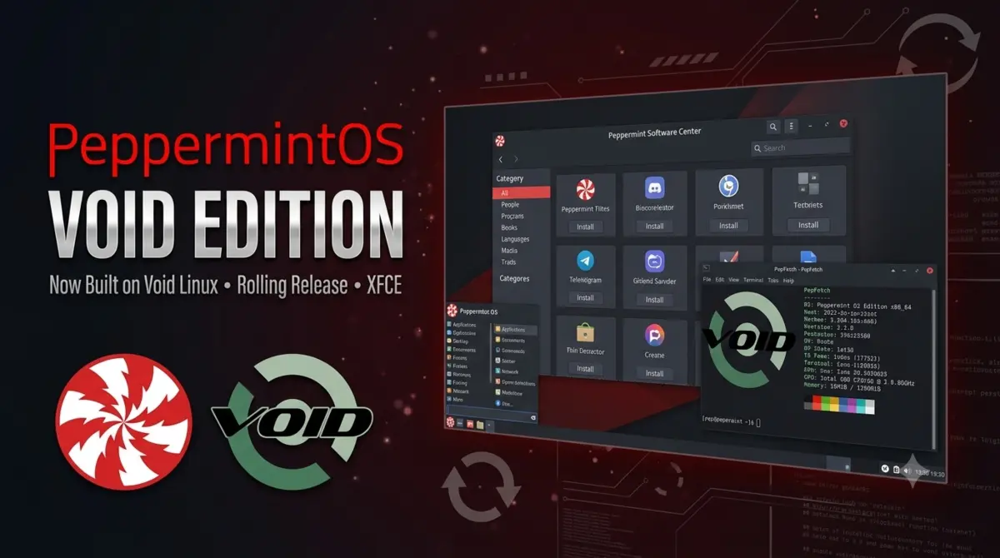

**Peppermint OS Void**, also called PepVoid, was announced on November 24, 2026. It is a Peppermint edition built on Void Linux, and the first ISO is the Loaded build with XFCE and the XLibre display server. It follows a rolling-release model, so you get updates as they arrive and do not wait for a major version.

The team says this is not a rebase. Peppermint is not moving to Void. It adds Void as another base next to the Debian and Devuan editions. If you like a rolling system and want Peppermint's light XFCE setup on top, this is the build to try. If you prefer fixed releases, stay with a Debian-based Peppermint such as [Peppermint OS on Bookworm](https://www.opensourcefeed.org/peppermintos-bookworm/), or read about [Devuan 6 Excalibur](https://www.opensourcefeed.org/devuan-6-excalibur-released/), the base of the systemd-free edition.

## What's new in Peppermint OS Void?

### The base

- **Void Linux base.** Void is an independent distro with its own package manager, XBPS. It gives Peppermint a base outside the Debian family.
- **Rolling updates.** There is no version number on this release. You install once and keep updating.
- **Loaded edition.** Apps come pre-installed, so the ISO is large at about 4 GB. A slimmer Flagship build of the Void edition is planned, with no date yet.
- **XLibre.** The display server matches the Debian and Devuan editions.

### Tools

- **Custom ISO builder.** The team tried Void's own `void-mklive` tool, found it did not fit, and wrote a builder of its own. The Pepvoid Builder is a Python toolkit with presets such as `minimal` and `desktop-xfce`, and the team has published documentation so you can build your own Void ISO.
- **Peppermint Software Center.** This is new in the release.
- **Peppermint Tools and PepFetch.** The tools have a refreshed interface, and the `pfetch` system info script has an update.
- **Build Ledger.** A [SourceForge wiki page](https://sourceforge.net/p/peppermintos/pepwiki/BuildDate/) lists what the system contains, which helps if you want to know what the ISO ships before you install.

## Download Peppermint OS Void

The ISO is `pepvoid-x86_64-linux-xfce-xlibre-loaded.iso`. Get it from the [official downloads page](https://peppermintos.com/trixie-base-downloads/), which links to SourceForge. The URL says "trixie-base", but the Void row sits on that page.

Check the download before you write it to a USB drive. The page offers a SHA512 checksum file, a `.asc` signature and a public key for the Void ISO. The Void ISO has its own public key file, separate from the Debian and Devuan editions, so download that one. The sample commands on the page use Devuan file names, so swap in the Void names when you copy them.

If you want to build your own image, start with the [Pepvoid Builder documentation](https://peppermint_os.codeberg.page/pepvoid-builder/index.html). It notes that a real build still needs host tools, network access and enough permissions.

## References

- [Peppermint OS Void (Loaded) release announcement](https://peppermintos.com/2026/11/peppermint-os-void-loaded-release/)
- [Peppermint OS downloads page](https://peppermintos.com/trixie-base-downloads/)
- [Pepvoid Builder documentation](https://peppermint_os.codeberg.page/pepvoid-builder/index.html)
- [Linuxiac: Peppermint OS Expands Beyond Debian with Void Linux-Based PepVoid](https://linuxiac.com/peppermint-os-expands-beyond-debian-with-void-linux-based-pepvoid/)
- [Void Linux](https://www.voidlinux.org)
