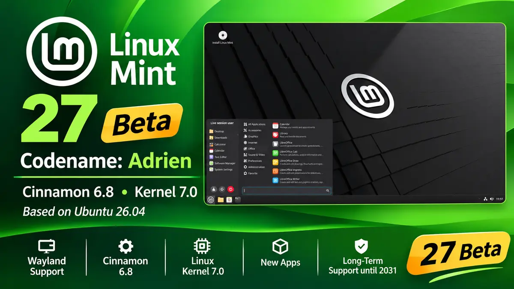

**The** Linux Mint team has released the Linux Mint 27 beta, codenamed "Adrien", on November 27, 2026. It is the first release in the new yearly cycle, it runs on Linux kernel 7.0, and it ships with Cinnamon 6.8, which now treats Wayland as fully supported. Cinnamon, Xfce and MATE editions are available as 64-bit ISOs.

This is a test release. The team says it may contain critical bugs, so keep it off your daily machine. If you are on Linux Mint 22.3 and want to try the new apps and the Wayland session, run the beta in a virtual machine or on a spare PC. The stable release is planned for around Christmas.

## What's new in Linux Mint 27?

Linux Mint 27 is a long-term support release with security updates until 2031. It is built on the Ubuntu 26.04 "Resolute" package base, and the team plans to add HWE ISOs when newer kernels arrive. Our earlier posts on [Ubuntu 26.04 LTS](https://www.opensourcefeed.org/ubuntu-26-04-resolute-raccoon-release/) cover the base system.

### Cinnamon 6.8

- **Wayland support:** The Wayland session now covers 3D acceleration, HiDPI, fractional scaling, keyboard layouts, input methods and touch gestures. The sources do not say which session is the default, so check the login screen.
- **New lock screen and screensaver:** Cinnamon now has its own, and it works on both Wayland and X11.
- **Touchpad gestures:** Animations follow your fingers, for example when you switch workspaces.
- **Nemo file manager:** A preview pane (F7) shows audio, image and video details, folders open faster, and tabs from the last window come back.
- **Screenshot tool:** You can capture a window with or without its shadow, pick a monitor and crop before you save.
- **Hardware and network:** WPA3 and OWE Wi-Fi networks, ambient light sensors and per-monitor wallpapers are supported.
- **Safer drive removal:** Cinnamon warns you if you unplug a drive too early, and copy progress counts only the data written to the disk.

### New apps

- **Clockenstein:** A calendar that works with local, Google and CalDAV calendars such as Nextcloud. A background service handles reminders even when the app is closed. The Cinnamon clock applet can show your events in the panel.
- **Clocks:** An alarm app with recurring alarms and custom sounds.
- **Velocitty:** A terminal with detachable tabs. Tab colors show superuser sessions (red) and remote sessions (blue).
- **Superlight:** A system monitor with graphs for CPU, memory, GPU, network, disk, temperatures and battery. It also shows disk use by folder, Steam games and Flatpaks.
- **Unfold:** An archive manager that uses 7-Zip and opens RAR and password-protected files.
- **Xepub:** An EPUB reader with highlights, notes and dictionary or Wikipedia lookups.
- **Thingy:** A redesigned Library for recent documents and favorites.

### System administration

- **Kernel management:** This tool moves out of Update Manager and works on Linux Mint and LMDE. You can pick which kernel series to track, and old kernels are cleaned up every week.
- **Sleep modes:** Hibernation returns, and so do hybrid sleep and suspend-then-hibernate. The new page helps you set them up.
- **Users and accounts:** You can turn on home directory encryption when you create a user, and take an account photo with a webcam.
- **Environment variables:** A new page sets system-wide variables for graphical and console sessions.

### Under the hood

- The Live Installer replaces Ubiquity, as it does in LMDE.
- Timeshift can pause automatic snapshots for a while.
- Xenity replaces Zenity for dialogs.
- Mint-Y gets better dark theme contrast and rounded corners.
- Fingerprint login no longer needs an extra Enter press.
- Cinnamon supports systemd-oomd and tells you when an app is killed.

## Download and test the Linux Mint 27 beta

The beta ISOs for Cinnamon, Xfce and MATE are linked from the [official announcement](https://blog.linuxmint.com/?p=5120). The main download page still lists Linux Mint 22.3 as the recommended version, so use the link in the announcement. The minimum requirements are 2 GB of RAM (4 GB recommended), 20 GB of disk space (100 GB recommended) and a 1024×768 screen.

Check the ISO with the published SHA-256 checksums and the GPG-signed version before you write it to a USB drive. The team will publish upgrade instructions after the stable release. It will support upgrades from this beta and from Linux Mint 22.3. If you find a bug, report it on GitHub with one issue per bug.

If you prefer Debian, see our post on [LMDE 7 "Gigi"](https://www.opensourcefeed.org/lmde7-gigi-debian-edition-release/). To see how far Mint has come, read about [Linux Mint 22](https://www.opensourcefeed.org/linuxmint-22-release/).

## References

- [Linux Mint 27 "Adrien" BETA announcement](https://blog.linuxmint.com/?p=5120)
- [What's new in Linux Mint 27](https://www.linuxmint.com/rel_adrien_whatsnew.php)
- [Linux Mint 27 release information](https://www.linuxmint.com/rel_adrien.php)
- [Cinnamon 6.8 released with hibernation support (OSNews)](https://www.osnews.com/story/146305/cinnamon-6-8-desktop-environment-released-with-hibernation-support/)
